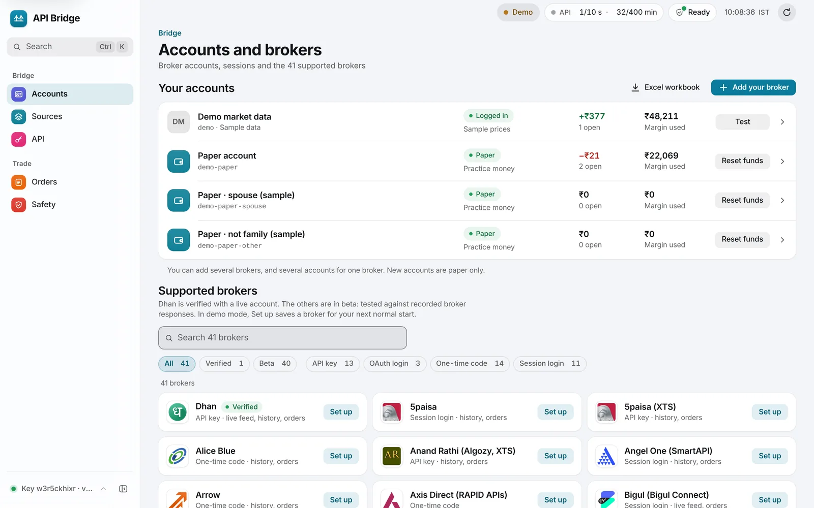
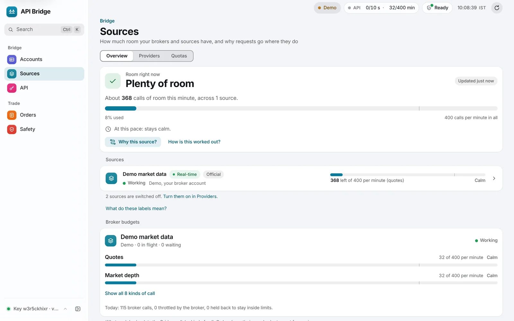
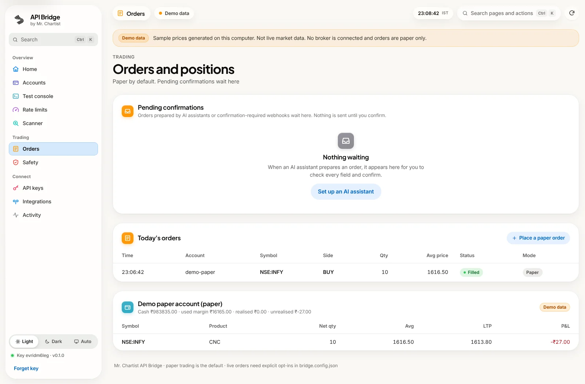

<div align="center">

# API Bridge

**One local API in front of all your Indian broker accounts.**

Your scripts, spreadsheets, AI assistants and dashboards talk to the Bridge. The Bridge talks to your brokers.<br>
Every tool shares the same connections and stays inside each broker's rate limits, and every order is a
**paper (practice) order unless you deliberately switch real trading on**.

[](LICENSE)


[Quick start](#quick-start) · [What you get](#what-you-get) · [Brokers](#supported-brokers) · [Safety](#safety-model) · [Guides](#guides-index) · [Contributing](#contributing)

</div>

<p align="center">
  <picture>
    <source media="(prefers-color-scheme: dark)" srcset="docs/screenshots/accounts-dark.webp">
    
  </picture>
  <picture>
    <source media="(prefers-color-scheme: dark)" srcset="docs/screenshots/sources-overview-dark.webp">
    
  </picture>
  <picture>
    <source media="(prefers-color-scheme: dark)" srcset="docs/screenshots/orders-dark.webp">
    
  </picture>
</p>

<p align="center"><sub>All screenshots are demo mode: sample data, no real account.</sub></p>

API Bridge is built by [Mr. Chartist](https://mrchartist.com). It runs on your own computer: there is no hosted service,
no account with us and no telemetry. It is an independent project, not affiliated with, sponsored by or endorsed by any
broker.

> [!IMPORTANT]
> **Beta software, not financial advice.** Only Dhan is verified with a live account. The other 40 brokers are beta or
> contract-tested ([how each is ranked](docs/BROKERS.md)). Trading involves risk of loss. Try everything in paper mode
> first and check figures against your broker before you ever turn live trading on. See [Safety](#safety-model) and the
> [licence](#license-trademarks-and-logos).

## Open source, source only

This repository **is** the product. The whole Bridge is here as source code under the
[GNU Affero General Public License v3.0](LICENSE): the server, the dashboard, the broker adapters, the SDKs, the
integrations, the tests and the docs.

- **There is no installer, EXE, ZIP or other packaged download**, here or anywhere else. If you find one, it did not come from us.
- You run it from this source with Node.js, or with Docker. Both take a few minutes: see [Quick start](#quick-start).
- It is not published to npm. Do not run `mc-bridge` through `npx`: that name on npm belongs to an unrelated package.
- You can read every line that touches your broker account before you run it.

---

## Contents

1. [Quick start](#quick-start)
2. [Why the Bridge](#why-the-bridge)
3. [What you get](#what-you-get)
4. [How it works](#how-it-works)
5. [Connect a broker](#connect-a-broker)
6. [API keys](#api-keys)
7. [Using the API](#using-the-api)
8. [Dashboard tour](#dashboard-tour)
9. [Supported brokers](#supported-brokers)
10. [Data sources](#data-sources)
11. [Orders and the safety model](#safety-model)
12. [Rate limits](#rate-limits)
13. [Connect your tools](#connect-your-tools)
14. [Save and replay data](#save-and-replay-data)
15. [Alerts, events and notifications](#alerts-events-and-notifications)
16. [Command line reference](#command-line-reference)
17. [Configuration](#configuration)
18. [Where your data lives, backup and restore](#where-your-data-lives-backup-and-restore)
19. [Security and privacy](#security-and-privacy)
20. [Updating and removing](#updating-and-removing)
21. [Troubleshooting](#troubleshooting)
22. [FAQ](#faq)
23. [What it does not do](#what-it-does-not-do)
24. [Guides index](#guides-index)
25. [Contributing](#contributing)
26. [License, trademarks and logos](#license-trademarks-and-logos)

---

## Quick start

You need **Node.js 22.12 or newer** (`node -v`) and git.

```bash
git clone https://github.com/MrChartist/Api-Bridge.git
cd Api-Bridge
npm ci
npm run dev        # demo mode: sample data, no broker, opens the dashboard
```

That is **demo mode**: sample prices, no broker, paper orders only. Nothing real can happen, and the dashboard opens
already signed in.

### Your first API call

To use the API from another program you need a key. In a second terminal, in the same folder:

```bash
npm run bridge -- keys create --label first --scope read,paper     # prints a key once: copy it
export MCB_API_KEY=mcb_...                                            # the key you were just shown
curl "http://127.0.0.1:4300/v1/ltp?symbols=NSE:RELIANCE" -H "Authorization: Bearer $MCB_API_KEY"
```

On Windows PowerShell:

```powershell
$env:MCB_API_KEY = "mcb_..."
Invoke-RestMethod "http://127.0.0.1:4300/v1/ltp?symbols=NSE:RELIANCE" -Headers @{ Authorization = "Bearer $env:MCB_API_KEY" }
```

(Use `curl.exe`, not `curl`, in Windows PowerShell 5.1: see [windows.md](docs/guides/windows.md).) The full walk-through
with the output of every command, a paper order and a WebSocket stream is
[docs/guides/quickstart.md](docs/guides/quickstart.md).

### Real prices

When you are ready, stop the demo and set up a broker: `npm run bridge -- init` (or use the dashboard), then
`npm run bridge -- start --open`. See [Connect a broker](#connect-a-broker).

### Docker

`docker compose up -d` builds and starts the Bridge from `docker-compose.yml`, published on `127.0.0.1:4300` only. The
first start writes a config and prints an admin key once: read it with `docker compose logs bridge`. Details:
[docker.md](docs/guides/docker.md). For an always-on server see [vps.md](docs/guides/vps.md).

### About the `mc-bridge` command

The rest of this README writes commands as `mc-bridge <command>`. From the repository folder that command is not on your
PATH, so run it as **`npm run bridge -- <command>`** (or `node bin/mc-bridge.mjs <command>`). For example,
`mc-bridge doctor` is `npm run bridge -- doctor`.

## Why the Bridge

Every Indian broker has its own login, its own API, its own symbols and its own rate limits. If you run a spreadsheet, a Python script, a charting tool and an AI assistant at the same time, each one logs in separately, they fight over the same limits, and a mistake in one can place an order from another.

The Bridge puts **one local service** in the middle:

- It keeps **one connection per broker** and shares it between all your tools.
- It speaks **one API shape** (REST, WebSocket and MCP) whichever broker is behind it.
- It **budgets requests** so no tool starves the others and no broker bans you.
- It **labels every price** with where it came from, how old it is and whether it is official.
- It makes real orders **hard to place by accident**, and keeps an audit log of everything.

It is for traders, developers and anyone building their own tools who would rather talk to one steady API than log in to and rate-limit each broker separately.

## What you get

| Area | What it does |
|---|---|
| **One API over 41 brokers** | Quotes, depth, option chains, expiries, history, positions, holdings, funds, orders and trades in the same shape for every broker. REST plus a WebSocket and SSE stream. |
| **Shared, fair rate limits** | Each broker's documented limits are enforced centrally. Every API key has its own quota, and a refused request says whose limit it hit and when to retry. |
| **Honest data sources** | Real-time prices come from your own broker. You can switch on free delayed or end-of-day sources, or add a plugin. Every answer is labelled with class, delay and officialness, and delayed data is never used for orders, risk checks, paper fills or alerts. |
| **Paper trading by default** | A full paper account with margin checks, fills, daily P&L, snapshots and a reset with undo. |
| **Hand trading** | An order ticket in the dashboard for Limit, Market, SL and SL-M orders, plus positions with profit and loss and one-click exit. |
| **Dashboard** | Signed-in dashboard for accounts, sources, orders, positions, keys, safety, downloads, recordings, collections, events, notifications and backup. |
| **AI assistants (MCP)** | An MCP server with 22 tools for Claude, Cursor and other assistants. The 19 read-only tools are on by default; the 3 order tools are off until you enable them. |
| **Webhooks and alerts** | Signed webhooks for events, plus inbound alert hooks for TradingView and ChartInk that turn alerts into orders under strict rules. |
| **Data tools** | History downloads, real-time quote and option-chain recorders, named collections of instruments and option universes, in CSV, JSONL or AmiBroker format. |
| **Compatibility API** | A compatibility REST layer so existing tools that expect a common trading-API shape can point at the Bridge. |
| **SDKs and integrations** | Node and Python clients, Excel Power Query files, a Google Sheets script, AmiBroker AFL, and starter projects (`mc-bridge init node`, `python`, `curl`, `sheets`, `webhook-receiver`, `mcp-client`). |
| **Telegram notifications** | Order, safety and download events to your own Telegram bot. |
| **Backup and restore** | One-command archive of your data, automatic copy before every version change. |
| **Kill switch** | One command (or button) stops live orders everywhere, optionally cancelling open ones. |

## How it works

```
 Excel · Google Sheets · AmiBroker · Python · Node · TradingView · AI assistants (MCP) · your own code
                                          │
                       one local address: http://127.0.0.1:4300
                                          │
        ┌─────────────────────────── the Bridge ───────────────────────────┐
        │  keys & scopes · rate-limit budgets · freshness labels · audit   │
        │  paper engine · live-order gate · events · recorder · dashboard  │
        └──────────────┬─────────────────┬─────────────────┬───────────────┘
                       │                 │                 │
                  Dhan, Zerodha,     free delayed /     your plugins
                  Upstox, Fyers…    end-of-day sources   (sandboxed)
```

- The Bridge listens on **`127.0.0.1` only**. Nothing else on your network can reach it unless you deliberately allow it.
- Broker credentials are stored **encrypted** in the Bridge's own data folder.
- Everything keeps working without us: there is no server of ours in the loop.

## Connect a broker

1. Open the dashboard and go to **Accounts**, or run `mc-bridge init --broker <id>` (the ids are in [BROKERS.md](docs/BROKERS.md)).
2. Add your account. The sign-in method depends on the broker: API key and token, OAuth login in the browser, a one-time code exchange, or a session login. The dashboard walks you through the one your broker uses.
3. **Log in again each trading day** for brokers whose sessions expire daily: Dashboard → Accounts → Log in, or `mc-bridge accounts connect <accountId>`.
4. Check it: `mc-bridge doctor` reports what works and what does not.

Your broker credentials never leave your computer except to go to that broker. They are stored encrypted in `secrets.enc`, sealed with a master key kept outside the data folder. See [accounts.md](docs/guides/accounts.md) and [Dhan](docs/guides/dhan.md) for a worked example.

## API keys

Every call from another program needs a key, except calls from this same computer when keyless access is on (the default, read, paper and admin access but **never live**). Keys have a **scope**:

| Scope | Allows |
|---|---|
| `read` | Prices, history, option chains, portfolio, order books |
| `paper` | Everything in `read`, plus paper orders |
| `live` | Live orders (the key must be created on this computer, and every other [live opt-in](#safety-model) must be in place) |
| `admin` | Settings and management; only from this computer |

```bash
mc-bridge keys create --label sheets --scope read --expires 90d
mc-bridge keys list
mc-bridge keys revoke <keyId>
```

Options: `--accounts a,b` limits a key to some accounts, `--expires 30d` sets an expiry, `--allow-query` lets a key travel in a web address (needed by some spreadsheet setups). Revoking a key closes its open connections at once. A key looks like `mcb_<keyId>_<secret>`; **treat it like a password**. Each key can have its own request quota.

## Using the API

The API is under `/v1` on `http://127.0.0.1:4300` (change the port with `MCB_PORT`, and tell clients with `MCB_BRIDGE_URL`). Send the key as `Authorization: Bearer <key>`.

### Examples

```bash
# last prices (several symbols at once)
curl "http://127.0.0.1:4300/v1/ltp?symbols=NSE:NIFTY,NSE:RELIANCE" -H "Authorization: Bearer $MCB_API_KEY"

# option chain (get a live expiry from /v1/expiries first)
curl "http://127.0.0.1:4300/v1/optionchain?underlying=NIFTY&expiry=2026-11-24&strikes=5" -H "Authorization: Bearer $MCB_API_KEY"

# a paper order (the default mode)
curl -X POST http://127.0.0.1:4300/v1/orders \
  -H "Authorization: Bearer $MCB_API_KEY" -H "Content-Type: application/json" -H "Idempotency-Key: 6f1c2a52-1b0e-4c53-9d0a-3f7a2b9e4c10" \
  -d '{"account":"demo-paper","symbol":"NSE:RELIANCE","side":"BUY","quantity":1,"product":"CNC","orderType":"MARKET","mode":"paper"}'
```

Every price answer carries a `freshness` block (`source`, `class` such as `realtime`, `delayed` or `eod`, `ageMs`, `official`). Partial failures come back with HTTP 200: `data[]` holds what worked and `errors[]` the rest. Every error has a stable `code` and a `requestId`; switch on `code`, never on wording. All errors: [docs/api/errors.md](docs/api/errors.md).

Writes take an **`Idempotency-Key`**: sending the same key again returns the first result, so a retry can never create a second order.

### Python

```python
from mrchartist_bridge import Bridge

bridge = Bridge()                                  # finds the URL and key itself
quote = bridge.quote("NSE:RELIANCE")
quote.require_realtime()                           # raises if the data is delayed, end-of-day or stale
order = bridge.orders.place("NSE:RELIANCE", "BUY", quantity=1, product="CNC", price=quote)   # paper unless live=True
```

Standard library only (Python 3.9+), with asyncio and pandas helpers. See [python.md](docs/guides/python.md) and `sdk/python`.

### Node.js

```js
import { BridgeClient } from "@mrchartist/bridge-client";

const bridge = new BridgeClient({ apiKey: process.env.MCB_API_KEY });
const { data, errors } = await bridge.ltp(["NSE:NIFTY", "NSE:RELIANCE"]);
```

Dependency-free, retries only when safe, never retries a write that got no reply. See [typescript.md](docs/guides/typescript.md) and `sdk/node`.

### Live streaming

One port serves WebSocket and SSE. Get a single-use token with `POST /v1/stream/token`, connect to `ws://127.0.0.1:4300/v1/stream?token=…`, then send `{"op":"subscribe","symbols":["NSE:NIFTY"],"mode":"quote"}`. You get a `snapshot`, then `tick`s, plus `subscribe_orders` for order updates. See [streaming.md](docs/guides/streaming.md).

### References

- [OpenAPI specification](docs/openapi.yaml) (REST) and [AsyncAPI specification](docs/asyncapi.yaml) (streams). The running Bridge also serves `/openapi.yaml`.
- [One page per endpoint](docs/api/README.md), with scope, parameters, fields, errors and curl and Python examples.
- [Symbols](docs/guides/symbols.md): `EXCHANGE:SYMBOL` format and conversion between brokers.
- [Compatibility API](docs/guides/compat-api.md) for tools that expect a common trading-API shape.
- For AI assistants reading the docs: [llms.txt](docs/llms.txt) and [llms-full.txt](docs/llms-full.txt).

## Dashboard tour

Open it any time with `mc-bridge open`. It is already signed in on this computer.

| Page | What it is for |
|---|---|
| **Accounts** | Add, log in, test and remove broker and paper accounts |
| **Sources** | How much request room each broker and data source has left; turn free delayed or end-of-day sources on or off; provider terms |
| **Orders / Positions** | The order ticket (Limit, Market, SL, SL-M), open orders, trades, positions with P&L and one-click exit |
| **Keys** | Create, scope, expire and revoke API keys |
| **Safety** | The live-trading switches, the kill switch and the readiness check |
| **Downloads, Recordings, Collections** | Save history and real-time data to files; named instrument lists |
| **Events, Notifications** | Event feed, signed webhooks, Telegram |
| **Backup** | Make and verify backups |
| **Developers** | API explorer, error list, copy-paste snippets |

The **Simple** view hides advanced pages; choose **Advanced** in the account menu, or press <kbd>Ctrl</kbd> <kbd>K</kbd> to search every page. It works on a phone too.

## Supported brokers

**41 Indian brokers**, with several accounts per broker allowed:

5paisa · 5paisa (XTS) · Alice Blue · Anand Rathi (Algozy) · Angel One · Arrow · Axis Direct · Bigul · Composite Edge · Definedge · **Dhan** · Firstock · Flattrade · Fyers · Goodwill · Groww · HDFC Securities · HDFC Sky · ICICI Direct · IIFL Capital · IIFL Securities (XTS) · IndiaBulls · IndMoney · Jainam · Kotak Securities (Neo) · Motilal Oswal · mStock · Nuvama Nubra · Paytm Money · Pocketful · Profitmart · RMoney · Rupeezy · SAMCO · Shoonya · Tradejini · TradeSmart · Upstox · Wisdom Capital · Zebu · Zerodha

Each broker sits on a four-step ladder, shown honestly in the dashboard:

1. **Beta**: built from recorded samples only.
2. **Contract-tested**: every contract case passes.
3. **Sandbox-verified**: checked against the broker's sandbox.
4. **Live-verified**: checked with a real account, with the date and who did it.

Today **Dhan** is live-verified. All others are beta or contract-tested, and **live orders for them are blocked by default**. The full table (sign-in method, option-chain Greeks, quotes and depth, live feed, portfolio, orders, official docs, status) is in [docs/BROKERS.md](docs/BROKERS.md).

## Data sources

Real-time prices come from **your own broker account**: no free real-time source exists in India that you may redistribute. For other needs you can turn on extra sources in the dashboard under **Sources**:

- Free **delayed** or **end-of-day** providers, each with its limits and terms shown, and an acknowledgement you must accept first.
- **Plugins** you write or trust: sandboxed processes with an empty environment, a locked-down file system, no child processes and no network except through the Bridge, pinned by checksum. Writing one: [source-contract.md](docs/source-contract.md).

Every answer says where it came from and how old it is. Data from a free source is **refused for orders, risk checks, paper fills and alerts**. Trace what answered a call with `mc-bridge sources trace --capability quotes --symbols NSE:RELIANCE`. More: [sources.md](docs/guides/sources.md).

## Safety model

**Paper by default.** Unless you do everything below, every order is a paper order.

A **live order** needs *all* of these:

1. `safety.liveTrading` switched on in the config file.
2. The account marked **live**.
3. The request source allowed for live.
4. An API key with the `live` scope, created on this computer.
5. `"mode": "live"` in the request.
6. An idempotency key on the request.
7. An armed, single-use, broker-bound order gate (every broker adapter refuses without one).

Further protections:

- **Kill switch**: `mc-bridge kill --reason "text" [--cancel-open]` stops live orders everywhere; `mc-bridge kill release` lifts it. Also in the dashboard under Safety.
- **Order previews and tickets**: `previewOrder` shows margin and effects before anything is sent; tickets can require confirmation.
- **Drift check**: a read-only periodic comparison of the Bridge's live orders with the broker's order book ([orders-drift.md](docs/guides/orders-drift.md)).
- **Audit log** of every order and sign-in.
- **Damaged records are set aside, not trusted**: after one, live orders resume only after you check the broker's order book and run `mc-bridge orders acknowledge-state`.
- **Pooling is off.** Spreading reads over several of your own accounts can give more room, but no broker's terms clearly allow it. It stays off until you accept a notice that names the risk.
- **Readiness check** (Dashboard → Safety) tells you what would stop a live order.

Read [safety.md](docs/guides/safety.md), [orders.md](docs/guides/orders.md) and [compliance.md](docs/guides/compliance.md) before going live.

## Rate limits

The Bridge keeps every broker inside its **documented** limits (with a source link and a `verified` flag per number) and divides the room fairly between your tools:

- Per-key quotas (dashboard → Keys, or the quotas API) so one noisy tool cannot starve the rest.
- Queues with a fair share per account; a request that cannot be served says `RATE_LIMITED` with `retryAfterMs` and whose limit it hit (`scope`: client, account or broker).
- Streams over polling: use the WebSocket for prices instead of calling in a loop.

See [rate-limits.md](docs/guides/rate-limits.md).

## Connect your tools

| Tool | How | Guide |
|---|---|---|
| **Excel** | Power Query files (`quotes.pq`, `history.pq`, `chain.pq`) and a template builder in `integrations/excel` | [excel-sheets.md](docs/guides/excel-sheets.md) |
| **Google Sheets** | `integrations/google-sheets/bridge.gs` with `BRIDGE_QUOTES`, `BRIDGE_CHAIN` and `BRIDGE_HISTORY` functions, reached through a safe tunnel | [excel-sheets.md](docs/guides/excel-sheets.md) |
| **AmiBroker** | `mrchartist-bridge.afl` include plus EOD and intraday import formats | [amibroker.md](docs/guides/amibroker.md) |
| **TradingView / ChartInk** | Inbound alert webhooks that become orders under strict, per-hook rules; `mc-bridge expose alerts` publishes only that route | [tradingview.md](docs/guides/tradingview.md), [webhooks.md](docs/guides/webhooks.md), [expose-alerts.md](docs/guides/expose-alerts.md) |
| **Claude Desktop, Claude Code, Cursor** | MCP over stdio (`mc-bridge mcp`) or HTTP (`/mcp`), 22 tools, read-only by default | [mcp.md](docs/guides/mcp.md) |
| **ChatGPT / OpenAI** | `mc-bridge openai-tools` prints tool definitions | [chatgpt-openai.md](docs/guides/chatgpt-openai.md) |
| **Python / Node / curl** | SDKs and starter projects: `mc-bridge init python`, `node`, `curl`, `sheets`, `webhook-receiver`, `mcp-client` | [python.md](docs/guides/python.md), [typescript.md](docs/guides/typescript.md) |
| **Other trading tools** | Compatibility REST layer | [compat-api.md](docs/guides/compat-api.md) |

Example, Claude Code with a read-only key:

```bash
mc-bridge keys create --label claude --scope read --client mcp
claude mcp add --transport http mr-chartist-bridge http://127.0.0.1:4300/mcp --header "Authorization: Bearer mcb_..."
```

## Save and replay data

All of this runs as background jobs on your computer and never slows down live reads.

- **History downloads**: `mc-bridge download NSE:RELIANCE --interval 5m --from 2024-01-01 --format csv`. Datasets keep growing from their last stored bar with `mc-bridge download update <dataset>`. Formats: CSV, JSONL, AmiBroker. See [downloads.md](docs/guides/downloads.md).
- **Recorders**: `mc-bridge record quotes NSE:NIFTY --every 5` saves real-time prices (one file per symbol per day); `mc-bridge record chain NIFTY --every 30 --strikes 10` saves option-chain snapshots. `mc-bridge record auto on` records by itself every trading day (off until you turn it on). See [recording.md](docs/guides/recording.md).
- **Collections**: named lists of instruments and *option universes* (ATM, rolling expiry) used by downloads, recordings and sheets: `mc-bridge collections create|universe|resolve|…`. See [collections.md](docs/guides/collections.md) and [data.md](docs/guides/data.md).

## Alerts, events and notifications

- **Events** (orders, logins, downloads, kill switch…) are available as a replayable stream, and as **signed webhooks** to your own program with retry and dead letters: `mc-bridge subscriptions add https://… --topics order.*`. See [events.md](docs/guides/events.md).
- **Telegram**: `mc-bridge notify telegram setup` connects your own bot (the token is read from a hidden prompt). See [telegram.md](docs/guides/telegram.md) and [notifications.md](docs/guides/notifications.md).
- **Alert orders**: TradingView and ChartInk alerts can place orders through hooks that fix the account, symbol rules, size limits, age limit and source IP, with duplicate protection. See [alert-orders.md](docs/guides/alert-orders.md).

## Command line reference

Run `mc-bridge --help` for everything. The most useful commands:

| Command | What it does |
|---|---|
| `mc-bridge init [--demo] [--broker <id>]` | First-run setup; also `init node\|python\|curl\|sheets\|webhook-receiver\|mcp-client` for starter projects |
| `mc-bridge start [--demo] [--open]` | Start the Bridge (and open the dashboard signed in) |
| `mc-bridge open` | Open the dashboard of the running Bridge, already signed in |
| `mc-bridge doctor [--strict] [--json]` | Check config, port, accounts, exposure and safety |
| `mc-bridge keys create\|list\|revoke` | Manage API keys |
| `mc-bridge accounts list\|connect <id>` | List accounts; log an account in |
| `mc-bridge sources list\|enable\|disable\|set-key\|test\|trace` | Manage data sources |
| `mc-bridge download …` / `record …` / `collections …` | Data tools |
| `mc-bridge subscriptions …` / `notify …` | Webhooks and Telegram |
| `mc-bridge expose [alerts\|sheets]` | Let TradingView alerts or a Google Sheet reach the Bridge through a tunnel, without exposing the dashboard |
| `mc-bridge backup` / `restore FILE` | Backups |
| `mc-bridge kill [release]` | Kill switch |
| `mc-bridge mcp --key <key>` | MCP over stdio |
| `mc-bridge openai-tools` | Tool definitions for OpenAI-style assistants |

More: [cli.md](docs/guides/cli.md).

## Configuration

Settings live in `bridge.config.json`. With no file the Bridge uses **safe defaults: paper only, `127.0.0.1:4300`**. `bridge.config.example.json` shows the shape and [config.md](docs/guides/config.md) lists every option with its type, range and default.

The config is found, in order, from `--config`, `MCB_CONFIG`, `./bridge.config.json`, then the per-user folder.

| Setting | How |
|---|---|
| Port | `MCB_PORT=4301` (and `MCB_BRIDGE_URL` for clients) |
| Demo mode | `--demo` or `MCB_DEMO=1` |
| Home folder | `MCB_HOME` |
| API key for the CLI and SDKs | `MCB_API_KEY` or `MCB_API_KEY_FILE` |
| Keyless access from this computer | `server.keylessSignIn`, `server.keylessApi` |
| Live trading | `safety.liveTrading` (off by default) |

## Where your data lives, backup and restore

| Platform | Settings and data folder |
|---|---|
| Windows | `%APPDATA%\MrChartist\Bridge` |
| Mac and Linux | `~/.mc-bridge` (override with `MCB_HOME`) |
| Running from the repository | `bridge.config.json` and `data` in the repository folder, if you keep them there |

It holds your encrypted broker secrets, API keys, paper books, the audit log, downloads and recordings. The **master key** that seals the secrets is kept outside the data folder and is **never** included in a backup.

```bash
mc-bridge backup --out my-backup.tar.gz       # one archive of your data (add --include-secrets if you want broker secrets inside)
mc-bridge backup verify my-backup.tar.gz    # check an archive
mc-bridge restore my-backup.tar.gz --dry-run # preview; the Bridge must be stopped to restore
```

The Bridge also copies your data to `backups/` before the first start of any new version, and keeps the newest five. See [backup.md](docs/guides/backup.md).

## Security and privacy

- **Local only.** The Bridge listens on `127.0.0.1`; other computers cannot reach it unless you allow it in the config. To let TradingView or a Google Sheet in, `mc-bridge expose` opens **only** the routes that need it, behind a tunnel or proxy, with IP rules, and `mc-bridge expose check` tests that nothing else answers.
- **No telemetry from us.** There is no hosted service. The Bridge only calls your brokers and the data sources you switched on.
- **Credentials**: encrypted at rest, never shown again after creation (keys are displayed once), never passed on the command line (prompts read them hidden).
- **Admin actions** (settings, keys, kill switch release) work only from this computer, even through a tunnel.
- **Sandboxed plugins** run with no secrets and no direct network.
- Report a vulnerability **privately** as described in [SECURITY.md](SECURITY.md); never post keys or tokens in a report.

## Updating and removing

**Update.** Stop the Bridge, `git pull`, `npm ci`, start it again. Your keys, paper accounts and audit log live in the data folder, not in the repository, so an update does not touch them. Before the first start of a new version the Bridge copies your data into `backups/`. To go back to an older version, check it out, then restore the copy made before the update (a Bridge refuses a backup made by a newer version). More: [upgrading.md](docs/guides/upgrading.md).

**Remove.** Delete the repository folder. Your settings and data stay in the data folder ([where it is](#where-your-data-lives-backup-and-restore)); delete that too if you no longer want them, after a backup.

## Troubleshooting

| You see | Likely cause and fix |
|---|---|
| "Port 4300 is already in use" | Another program or a second Bridge has it. Close it, or set `MCB_PORT=4301` and `MCB_BRIDGE_URL` |
| "The Bridge is already running" | One Bridge per data folder. Use it: `mc-bridge open` |
| Dashboard asks you to sign in | The sign-in link works once. `mc-bridge open` prints a fresh one |
| Blank dashboard | Reload with <kbd>Ctrl</kbd>+<kbd>F5</kbd>, try a private window, run `mc-bridge doctor` |
| "DEMO DATA" everywhere | You are in demo mode. Add a broker account for real prices |
| `SESSION_EXPIRED`, no prices | Your broker login ended (most brokers need a fresh login every day). Dashboard → Accounts → Log in |
| A price is old, `stale: true`, `class` is `delayed` or `eod` | The market is closed, the feed is silent, or the answer came from a free delayed source. Read `freshness` on the answer |
| `PAPER_ONLY` or `ORDER_GATE_CLOSED` | A live order is missing one of the live opt-ins ([list](#safety-model)). Paper orders need none |
| `MARKET_CLOSED` | The exchange is closed; `GET /v1/calendar/status` says when it opens |
| `RATE_LIMITED` | Wait `retryAfterMs`; use the stream instead of polling |
| `mc-bridge: command not found` | Run it as `npm run bridge -- <command>` from the repository folder |
| Excel shows `#NAME?` or `NO ANSWER` | Old workbook, wrong address or key: [excel-sheets.md](docs/guides/excel-sheets.md) |
| `LOOPBACK_ONLY` through a tunnel | Admin actions never work from outside; do it on the computer running the Bridge |

When you report a problem, include the `requestId` from the error, what `mc-bridge doctor` prints and the Bridge version. **Never paste a key.** The complete list is in [troubleshooting.md](docs/guides/troubleshooting.md).

## FAQ

**Is it free?** Yes. It is open source under the [AGPL-3.0](LICENSE): use, study, change and share it. If you run a modified version for other people over a network, you must offer them your changes under the same licence.

**Is there an installer or an EXE?** No. The project is source only: clone this repository and run it with Node.js or Docker ([Quick start](#quick-start)). We do not publish an installer, an EXE, a ZIP or an npm package.

**Does it send my data or keys anywhere?** No. It runs on your computer and talks only to your brokers and the sources you enable.

**Can it place real orders?** Only after you switch live trading on and satisfy every [opt-in](#safety-model). Until then, paper only.

**Is real-time data free?** Real-time prices come from your own broker account. The Bridge does not provide free real-time data, because none exists in India that may be redistributed.

**Can several tools use it at once?** Yes, that is the point: they share connections and each key has its own quota.

**Can I use it from my phone or another computer?** From another computer only if you deliberately allow it in the config.

**Do I need Node.js?** Yes, 22.12 or newer (`node -v`). Docker needs only Docker.

**Which broker should I start with?** Dhan is the only one verified with a live account. Start any broker in paper mode first.

More answers: [faq.md](docs/guides/faq.md).

## What it does not do

- It is a **connection layer**, not a trading desk: no analytics, scanners, journal or strategies. Build those on top of the API.
- It gives **no financial advice** and does not recommend trades.
- It does **not** provide free real-time market data.
- It does **not** make a beta broker safe for live trading. Try it in paper mode and check figures against your broker.
- It is **not** a hosted service: there is no account with us and nothing to sign up for.

## Guides index

[Quickstart](docs/guides/quickstart.md) · [FAQ](docs/guides/faq.md) · [Accounts](docs/guides/accounts.md) · [Rate limits](docs/guides/rate-limits.md) · [Sources](docs/guides/sources.md) · [Safety](docs/guides/safety.md) · [Orders](docs/guides/orders.md) · [Alert orders](docs/guides/alert-orders.md) · [Data](docs/guides/data.md) · [Downloads](docs/guides/downloads.md) · [Recording](docs/guides/recording.md) · [Collections](docs/guides/collections.md) · [Events](docs/guides/events.md) · [Telegram](docs/guides/telegram.md) · [Backup](docs/guides/backup.md) · [Streaming](docs/guides/streaming.md) · [Excel and Sheets](docs/guides/excel-sheets.md) · [AmiBroker](docs/guides/amibroker.md) · [Python](docs/guides/python.md) · [TypeScript](docs/guides/typescript.md) · [MCP](docs/guides/mcp.md) · [ChatGPT](docs/guides/chatgpt-openai.md) · [TradingView](docs/guides/tradingview.md) · [Webhooks](docs/guides/webhooks.md) · [Docker](docs/guides/docker.md) · [VPS](docs/guides/vps.md) · [Windows](docs/guides/windows.md) · [Operations](docs/guides/operations.md) · [Troubleshooting](docs/guides/troubleshooting.md) · [Glossary](docs/guides/glossary.md) · [Configuration](docs/guides/config.md) · [CLI](docs/guides/cli.md)

Reference: [docs home](docs/README.md) · [one page per endpoint](docs/api/README.md) · [openapi.yaml](docs/openapi.yaml) · [asyncapi.yaml](docs/asyncapi.yaml) · [ARCHITECTURE.md](docs/ARCHITECTURE.md) · [BROKERS.md](docs/BROKERS.md) · [CHANGELOG.md](CHANGELOG.md)

## Contributing

The Bridge is open source so that people can check it, fix it and extend it. Contributions are welcome: bug fixes with a test, doc fixes, and broker reports (try a broker in paper mode and tell us what happened). Start with [CONTRIBUTING.md](CONTRIBUTING.md), which has a quick path for a first pull request. Run the tests with `npm test`. Report vulnerabilities privately as described in [SECURITY.md](SECURITY.md), never in a public issue.

Questions and bug reports go to the [issue tracker](https://github.com/MrChartist/Api-Bridge/issues). Include the `requestId`, what `mc-bridge doctor` prints and the Bridge version, and never paste a key.

## License, trademarks and logos

The Bridge and its documentation are © 2026 Mr. Chartist and licensed under the [GNU Affero General Public License v3.0](LICENSE) (SPDX: `AGPL-3.0-only`). You may use, study, change and share it; if you run a modified version as a service for other people, you must offer them your changes under the same licence. Broker names and the broker logos shown in the dashboard are trademarks of their owners; they are **not under the project licence**, are used only to identify each broker, and do not mean any broker is affiliated with or endorses this project. Licences of the packages that ship with the Bridge are in [THIRD-PARTY-NOTICES.md](THIRD-PARTY-NOTICES.md).

