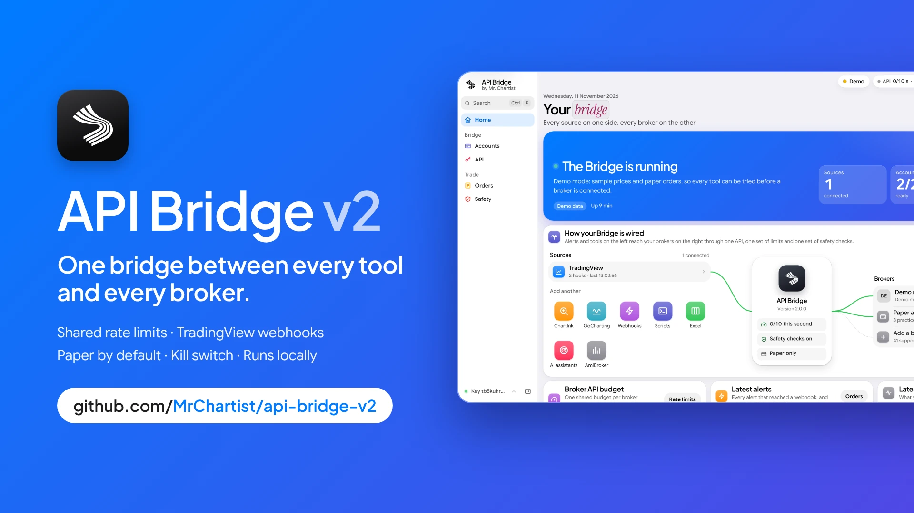
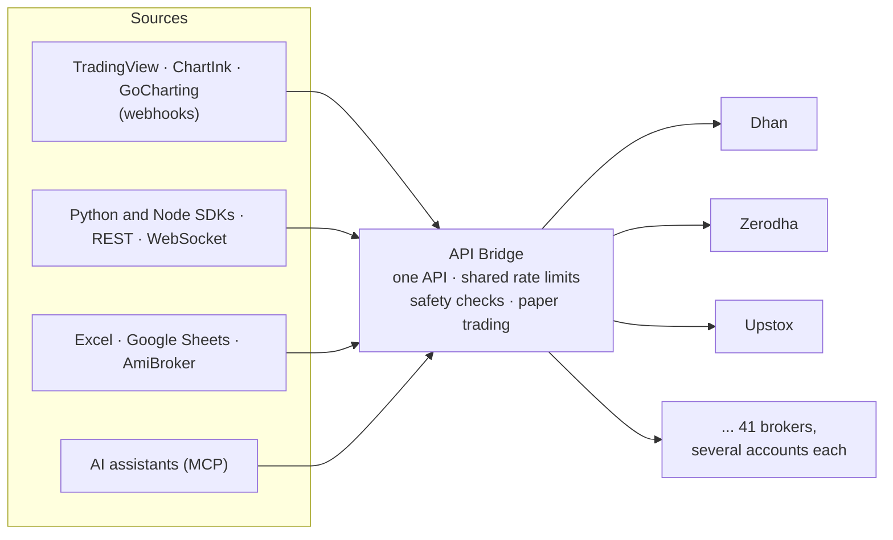
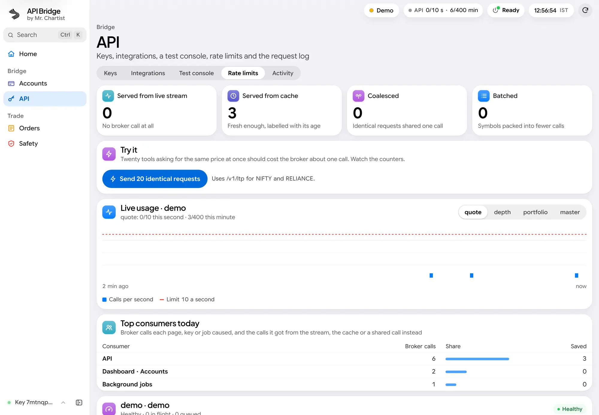
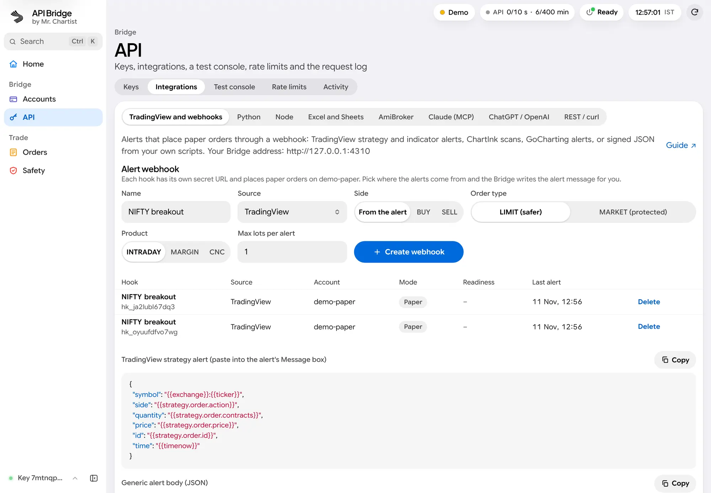
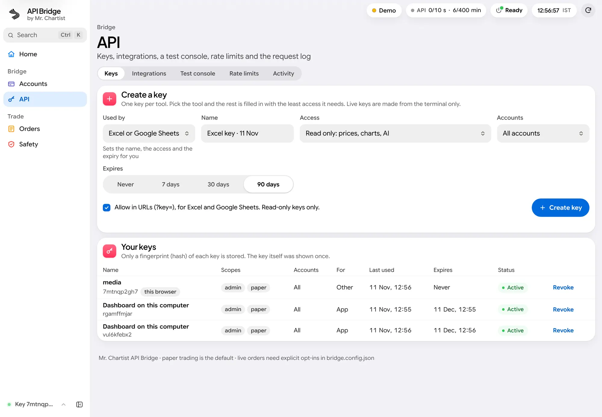
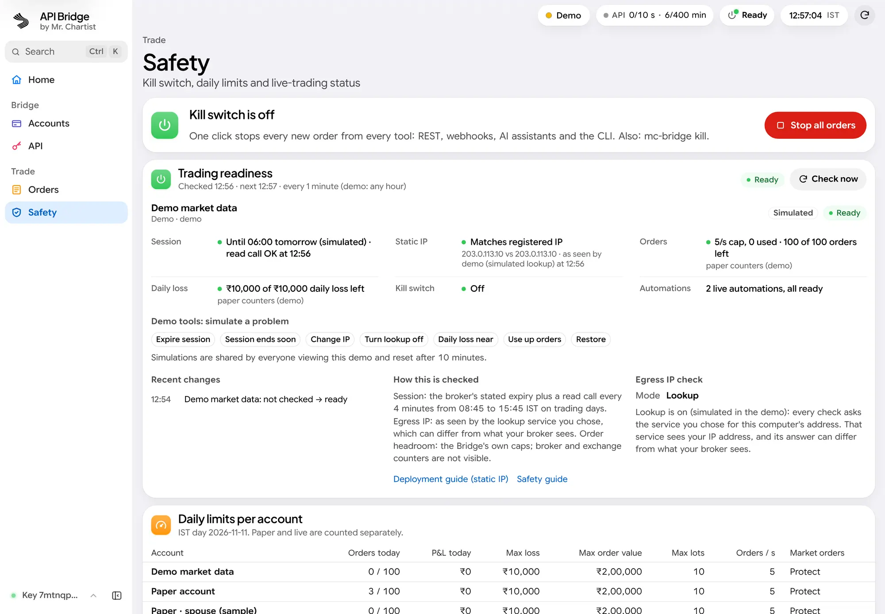
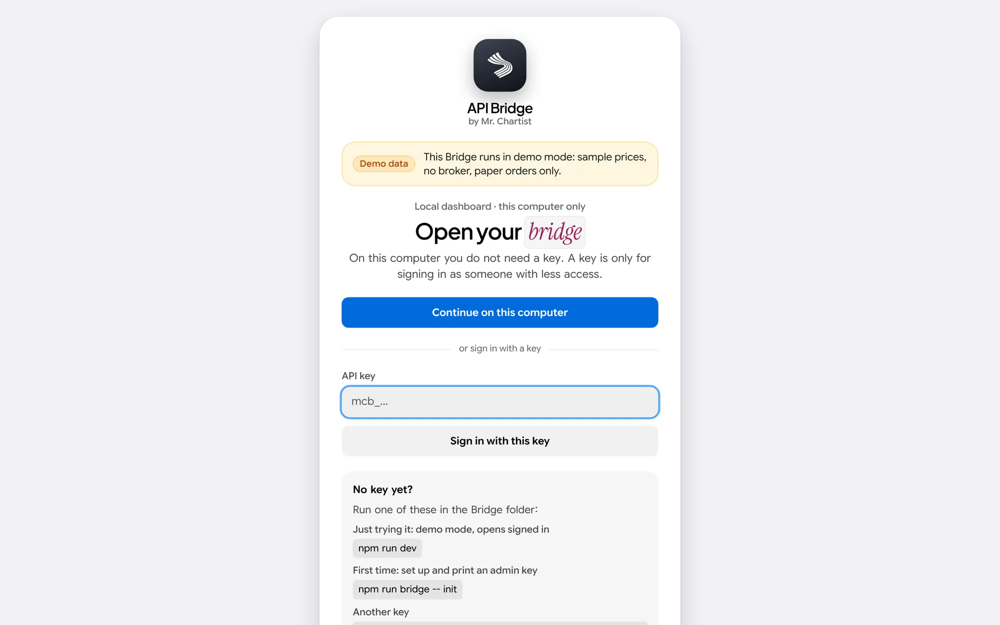
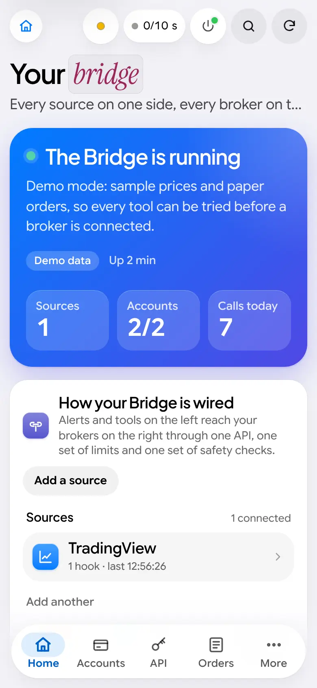

# API Bridge v2

**Connect your broker APIs in one place, route alerts from TradingView and your own tools to them, and stay inside
every broker's rate limits.**

A small service by Mr. Chartist that runs on your own computer. Paper trading by default. Beta.

<p align="center">
  
</p>

<p align="center">
  <a href="docs/media/announcement.mp4">
    
  </a>
  <br>
  <a href="docs/media/announcement.mp4"><b>Watch the 60-second tour</b></a>
</p>

## What it is

On one side, API Bridge takes alerts and API calls from the tools you already use. On the other side, it holds your
Indian broker accounts: 41 broker adapters, several accounts per broker. In between there is one API, one rate-limit
budget per broker account that every tool shares, and one set of safety checks. Your tools do not need to know which
broker they are talking to, and two tools cannot use up the same broker's limit between them.



<details>
<summary>Same diagram as text</summary>

```
 TradingView  ChartInk  GoCharting  ─┐                                  ┌─  Dhan
 Python  Node  REST  WebSocket      ─┤   API Bridge                     ├─  Zerodha
 Excel  Google Sheets  AmiBroker    ─┤   rate limits · safety · paper   ├─  Upstox
 Claude  ChatGPT (MCP)              ─┘                                  └─  ... 41 brokers
```

</details>

**Who it is for:** traders who send alerts from charting sites to a broker, and developers who run several scripts,
sheets or bots against the same broker accounts and keep hitting rate limits.

## Quick start

Requires Node.js 22 or newer.

```bash
git clone https://github.com/MrChartist/api-bridge-v2.git
cd api-bridge-v2
npm ci
npm run dev        # demo mode: sample prices, paper accounts, no broker needed; opens the dashboard
```

When you are ready to use your own accounts:

```bash
cp bridge.config.example.json bridge.config.json   # accounts, ports, limits
npm start          # start the Bridge
npm run doctor     # check the setup
```

The dashboard is at **http://localhost:4300/dashboard**. On the computer the Bridge runs on, it opens without a key
(`POST /v1/sign-in/local`, loopback only). To always ask for a key instead, set `"server": { "keylessSignIn": false }`;
see [safety.md](docs/guides/safety.md#signing-in-to-the-dashboard). The health check is at `/v1/health`.

Other commands: `npm test`, `npm run typecheck`, `npm run check:mjs`, `npm run capabilities`, and the CLI with
`npm run bridge -- <command>`.

## TradingView in two minutes

1. Run the Bridge, open **API → Integrations → TradingView and webhooks** and choose **Create webhook**
   (the source defaults to TradingView).
2. Copy the hook URL (shown once; only a hash is kept) and the alert message the Bridge wrote for it.
3. TradingView only posts to a public HTTPS address on port 443. Turn on the public ingress listener
   (`server.publicIngress.enabled` in `bridge.config.json`; it serves `/hooks/*` and nothing else) and run your own tunnel to it, for example
   `cloudflared tunnel --url http://127.0.0.1:4301`.
4. In TradingView, create an alert, tick **Webhook URL**, paste `https://<tunnel host>/hooks/tradingview/<token>`,
   and paste the message.
5. Fire the alert. Home shows it under **Latest alerts** within a few seconds: placed, or refused with the reason.

Orders from a hook are paper unless you opt in to live trading. The strategy template carries `id` and `time`, so a
resent alert never places a second order that day. An unfilled `{{placeholder}}` refuses the alert instead of
guessing, and a chart on a continuous future (`NIFTY1!`) is resolved to the current front-month contract. Details, ChartInk, GoCharting and signed hooks for your own code:
[webhooks.md](docs/guides/webhooks.md).

## How the shared rate-limit budget works

Most broker APIs allow very few requests, often one quote call a second. Ten tools polling on their own break that in
seconds. The Bridge makes the broker see one careful client:

- **One budget per broker account.** Each account has token buckets per kind of call (orders, quotes, depth,
  history, option chains, portfolio, ...), filled from each broker's documented limits. Every tool draws from the
  same buckets. Config can only lower these limits, never raise them.
- **Ask the broker less.** Before a read reaches the broker, the Bridge tries, in order: the live stream (if anyone is
  streaming the symbol, no broker call), a short freshness cache, joining an identical call already in flight, and
  batching symbols from different tools into one call.
- **Queue, never burst.** What is left waits in a priority queue. Orders go first; background work waits. When the
  broker says "too many requests", only that account and kind of call back off.
- **When the budget runs out**, you get a cached value labelled `"stale": true`, a per-symbol `UPSTREAM_RATE_LIMITED`
  with a retry time, or `429` with `Retry-After`. Never a quiet burst over the limit.
- **Each API key has its own budget too** (50 requests a second by default), so one runaway script cannot starve the rest.

You can watch it: the API capsule in the top bar, the budget card on Home, and **API → Rate limits** (calls per
second against the limit, calls saved, top consumers). `GET /v1/usage` returns the same figures. Several accounts of
one holder can share read load if you opt in per account. More in [rate-limits.md](docs/guides/rate-limits.md).

## Safety

- **Paper by default.** Every order, webhook and AI tool is paper unless it explicitly asks for live. The paper
  account is a local simulator priced from market data.
- **Live trading is off by default** and needs every one of these: `safety.liveTrading: true` in
  `bridge.config.json`, `live.enabled` on the account, the request source (REST, webhook, MCP, CLI) allowed for that
  account, an API key with the `live` scope (created on this computer only), `"mode": "live"` in the request, an
  idempotency key, and human confirmation for AI assistants. Nothing in the API, a webhook or an MCP tool can switch
  live trading on.
- **Kill switch.** One click on the Safety page, `POST /v1/safety/kill-switch`, or `mc-bridge kill` stops every new
  order, including orders already queued.
- **Checks on every order, paper and live:** 5 orders a second per account, 100 orders and ₹10,000 loss per day,
  ₹2,00,000 per order, 10 lots per order, limit prices within 3% of LTP, market orders sent as protected limits.
  All are configurable, and an account can be stricter, never looser.
- Live orders are mapped for **Dhan** (verified), **Zerodha** and **Upstox** (beta, with a warning on every live
  order). Other brokers answer live orders with a "use paper mode" error.
- The Bridge binds `127.0.0.1`, stores broker credentials encrypted, never stores passwords, PINs or TOTP codes, and
  keeps a hash-chained audit log.

Full model: [safety.md](docs/guides/safety.md).

## Screenshots

All taken from demo mode: sample prices and paper accounts, no real broker.

| | |
|---|---|
|  |  |
| Home, light | Home, dark |
|  |  |
| Rate limits | TradingView and webhooks |
|  |  |
| API keys | Safety |
|  |  |
| Sign-in | Home on a phone |

## Supported brokers

**41 Indian broker adapters**, several accounts per broker, logged in from the dashboard.

- **Dhan** is verified end to end with a live account.
- **Every other broker is beta:** written from the broker's official API documentation and tested against recorded
  sample responses, not yet verified with a live account. Please check results against your broker and report what
  you find.

The full table (sign-in type, option chain, quotes, live feed, portfolio, orders, status per broker) is in
[docs/BROKERS.md](docs/BROKERS.md).

## Connect your tools

| Tool | How | Guide |
|---|---|---|
| TradingView, ChartInk, GoCharting, your own signed alerts | Webhooks | [webhooks.md](docs/guides/webhooks.md) |
| Python | SDK in `sdk/python` | [python.md](docs/guides/python.md) |
| Node and TypeScript | SDK in `sdk/node` | [typescript.md](docs/guides/typescript.md) |
| Excel, Google Sheets | Read-only `/xl` routes, files in `integrations/` | [excel-sheets.md](docs/guides/excel-sheets.md) |
| AmiBroker | AFL and ASCII import, files in `integrations/amibroker` | [amibroker.md](docs/guides/amibroker.md) |
| Claude Desktop, Claude Code, Cursor | MCP | [mcp.md](docs/guides/mcp.md) |
| ChatGPT and OpenAI function calling | Tools | [chatgpt-openai.md](docs/guides/chatgpt-openai.md) |
| Existing algo tools | Compat API at `/api/v1` | [compat-api.md](docs/guides/compat-api.md) |
| Anything else | REST and WebSocket | [openapi.yaml](docs/openapi.yaml), [asyncapi.yaml](docs/asyncapi.yaml), [streaming.md](docs/guides/streaming.md) |

## Docs

- [Accounts](docs/guides/accounts.md): adding brokers and several accounts, sessions.
- [Rate limits](docs/guides/rate-limits.md), [Safety](docs/guides/safety.md), [Webhooks](docs/guides/webhooks.md).
- [Deployment](docs/guides/deployment.md): static IP for live orders and the daily login.
- [Compliance](docs/guides/compliance.md): the SEBI, exchange and broker rules that shape the design.
- [Architecture](docs/ARCHITECTURE.md), [broker contract](docs/broker-contract.md), [changelog](CHANGELOG.md).

## What is not in v2

v2 is the API connection layer and a small dashboard (Home, Accounts, API, Orders, Safety). Analytics, scanners,
calendars, the recorder, option desks, the journal, alerts and the other trading-desk features are not part of it.
The full app lives in [MrChartist/api-bridge](https://github.com/MrChartist/api-bridge).

## License

MIT, see [LICENSE](LICENSE).
