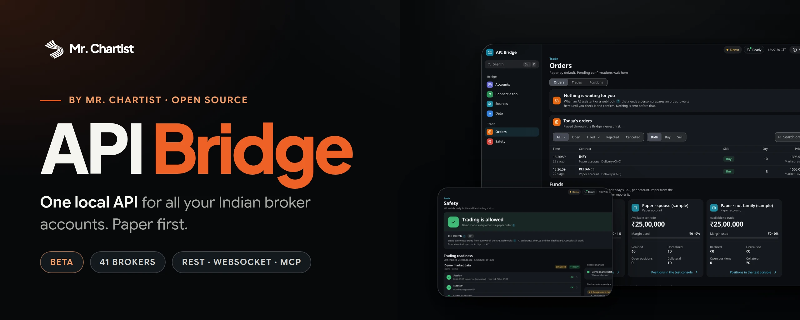
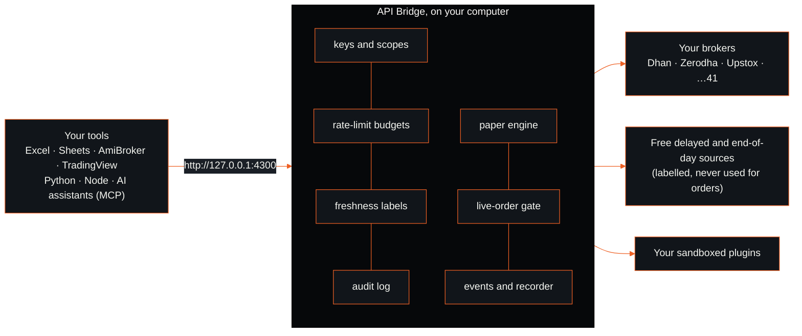

<p align="center"></p>

# API Bridge

**One local API in front of every Indian broker you use.** Spreadsheets, scripts, charts and AI assistants share one rate-limited connection per broker, and every order is a practice order until you deliberately switch live trading on.

<p>     </p>

Version 2.0.0 · **Status: beta** · Runs on your own computer: no hosted service, no account with us · AGPL-3.0 · An independent project, not affiliated with, sponsored by or endorsed by any broker.

> [!WARNING]
> **Beta software, not financial advice.** Only Dhan is verified with a live account; the other 40 brokers are beta or contract-tested ([how each is ranked](docs/BROKERS.md)). Trading involves risk of loss. Try everything in paper mode first, and check figures against your broker before you ever turn live trading on.

## Open source, source only

This repository **is** the product. The whole Bridge is here as source code under the [GNU Affero General Public License v3.0](LICENSE): the server, the dashboard, the broker adapters, the SDKs, the integrations, the tests and the docs.

- **There is no installer, EXE, ZIP or other packaged download**, here or anywhere else. If you find one, it did not come from us.
- You run it from this source with Node.js, or with Docker. Both take a few minutes: see [Quick start](#quick-start).
- It is not published to npm. Do not run `mc-bridge` through `npx`: that name on npm belongs to an unrelated package.
- You can read every line that touches your broker account before you run it.

---

## Why API Bridge

Every Indian broker has its own login, its own API, its own symbols and its own rate limits. Run a spreadsheet, a Python script, a charting tool and an AI assistant at once and each one logs in separately, they fight over the same limits, and a mistake in one can place an order from another. The Bridge puts one local service in the middle.

- **One API shape for 41 brokers.** Quotes, depth, option chains, history, positions, funds and orders look the same whichever broker is behind them, with `EXCHANGE:SYMBOL` everywhere.
- **One connection per broker, shared fairly.** Each broker's documented limits are enforced in one place, and every API key has its own quota.
- **Honest data.** Every price says where it came from, how old it is and whether the source is official. Delayed or end-of-day data is never used for an order, a risk check, a paper fill or an alert.
- **Paper first.** A live order needs eight separate opt-ins, and one command stops live orders everywhere.
- **Local only.** It listens on `127.0.0.1`, keeps your broker secrets encrypted on your own disk, sends no telemetry, and has no server of ours in the loop.
- **Works with what you already use.** Excel, Google Sheets, AmiBroker, TradingView, Claude and Cursor (over MCP), Python and Node.

<table>
<tr><th align="left">Without the Bridge</th><th align="left">With the Bridge</th></tr>
<tr><td>One login per tool, repeated every day</td><td>One login per broker, shared by all your tools</td></tr>
<tr><td>Tools fight over rate limits and risk a ban</td><td>One budget, a fair share per key, and a clear <code>retryAfterMs</code></td></tr>
<tr><td>Every broker formats symbols differently</td><td><code>EXCHANGE:SYMBOL</code> everywhere</td></tr>
<tr><td>You never know how old a price is</td><td>A <code>freshness</code> label on every answer</td></tr>
<tr><td>A typo can place a real order</td><td>Paper by default, eight opt-ins for live, a kill switch</td></tr>
<tr><td>An AI assistant needs your raw broker keys</td><td>Read-only MCP; an order is a ticket a person confirms</td></tr>
<tr><td>No record of what was sent</td><td>An audit log of every order and sign-in</td></tr>
</table>

<p align="center">
  <picture>
    <source media="(prefers-color-scheme: dark)" srcset="docs/screenshots/orders-dark.webp">
    
  </picture>
  <picture>
    <source media="(prefers-color-scheme: dark)" srcset="docs/screenshots/safety-dark.webp">
    
  </picture>
</p>
<p align="center"><sub>The real dashboard, in demo mode: sample data, no real account. More: <a href="docs/screenshots/sources-overview-dark.webp">sources</a> · <a href="docs/screenshots/api-keys-dark.webp">API keys</a> · <a href="docs/screenshots/accounts-phone.webp">on a phone</a>.</sub></p>

## Quick start

You need **Node.js 22.12 or newer** (`node -v`) and git. Start in **demo mode**: sample prices, no broker, paper orders only, so nothing real can happen.

```bash
git clone https://github.com/MrChartist/Api-Bridge.git
cd Api-Bridge
npm ci
npm run dev        # demo mode: opens the dashboard, already signed in
```

The dashboard opens in your browser by itself. If it does not, open `http://127.0.0.1:4300/dashboard` in the browser's address bar (not in the terminal).

In a second terminal, from the same folder, make a key and ask for a price:

```bash
npm run bridge -- keys create --label first --scope read,paper     # prints a key once: copy it
export MCB_API_KEY=mcb_...                                          # the key you were just shown
curl -s "http://127.0.0.1:4300/v1/ltp?symbols=NSE:NIFTY,NSE:RELIANCE" -H "Authorization: Bearer $MCB_API_KEY"
```

Then place a **paper** order (the default mode):

```bash
curl -s -X POST http://127.0.0.1:4300/v1/orders -H "Authorization: Bearer $MCB_API_KEY" -H "Content-Type: application/json" -H "Idempotency-Key: 6f1c2a52-1b0e-4c53-9d0a-3f7a2b9e4c10" -d '{"account":"demo-paper","symbol":"NSE:RELIANCE","side":"BUY","quantity":1,"product":"CNC","orderType":"MARKET","mode":"paper"}'
```

<details>
<summary><b>Windows PowerShell</b></summary>

```powershell
$env:MCB_API_KEY = "mcb_..."
Invoke-RestMethod "http://127.0.0.1:4300/v1/ltp?symbols=NSE:RELIANCE" -Headers @{ Authorization = "Bearer $env:MCB_API_KEY" }
```

In Windows PowerShell 5.1 `curl` is an alias of another command, so use `Invoke-RestMethod` or `curl.exe`. More in [windows.md](docs/guides/windows.md).

</details>

The full walk-through, with the output of every command, is [docs/guides/quickstart.md](docs/guides/quickstart.md). For real prices, stop the demo, run `npm run bridge -- init` (or use the dashboard's Accounts page) to add a broker, then `npm start`.

### About the `mc-bridge` command

From the repository folder the `mc-bridge` command is not on your PATH. Every `mc-bridge ...` command in this README and in the guides is run as `npm run bridge -- <command>` (or `node bin/mc-bridge.mjs <command>`), for example `npm run bridge -- doctor`. Do not run it through `npx`: that name on npm belongs to an unrelated package.

### Docker

`docker compose up -d` builds and starts the Bridge on `127.0.0.1:4300` only, in a hardened container (read-only filesystem, all capabilities dropped). The first start prints an admin key once: read it with `docker compose logs bridge`. Details: [docker.md](docs/guides/docker.md); for an always-on server see [vps.md](docs/guides/vps.md).

## What you can do with it

<table>
<tr><td width="33%"><b>Read the market</b><br>Quotes, depth, option chains, expiries, history and the exchange calendar, as REST, a WebSocket and SSE stream.</td>
<td width="33%"><b>Trade on paper, then for real</b><br>A full paper account, previews, tickets a person confirms, and a hand-trading order ticket in the dashboard.</td>
<td width="33%"><b>Plug in your tools</b><br>Excel, Sheets, AmiBroker, TradingView, Claude and Cursor, Python and Node, all through the same key system.</td></tr>
<tr><td><b>Save data</b><br>History downloads, real-time quote and option-chain recorders and named collections, as CSV, JSONL or AmiBroker files.</td>
<td><b>React to events</b><br>Signed webhooks with retries, a replayable event stream, and Telegram messages to your own bot.</td>
<td><b>Stay safe</b><br>Kill switch, daily limits, a readiness check, an order-book drift check and an audit log.</td></tr>
</table>

**Python** (standard library only, Python 3.9+; install from the folder with `pip install ./sdk/python`):

```python
from mrchartist_bridge import Bridge

bridge = Bridge()                                   # reads MCB_BRIDGE_URL and MCB_API_KEY
quote = bridge.quote("NSE:RELIANCE")
quote.require_realtime()                            # raises if the data is delayed, end-of-day or stale
order = bridge.orders.place("NSE:RELIANCE", "BUY", quantity=1, product="CNC", price=quote)   # paper unless live=True
```

**Claude Code over MCP** (22 tools; the 3 order tools are off by default):

```bash
npm run bridge -- keys create --label claude --scope read --client mcp
claude mcp add --transport http mr-chartist-bridge http://127.0.0.1:4300/mcp --header "Authorization: Bearer mcb_..."
```

**Node.js** clients live in `sdk/node` (`@mrchartist/bridge-client`, installed from the folder, not from npm): see [typescript.md](docs/guides/typescript.md). **Streaming:** one port serves WebSocket and SSE; see [streaming.md](docs/guides/streaming.md).

## How it works



- The Bridge listens on **`127.0.0.1` only**. Nothing else on your network can reach it unless you deliberately allow that.
- Broker credentials are stored **encrypted** in the Bridge's own data folder; the master key that seals them is kept outside it and is never part of a backup.
- Everything keeps working without us: there is no server of ours in the loop and no telemetry.

## Safety model

**Paper by default.** Unless all of the following are true, an order is a paper order. A **live order** needs every one of these ([safety.md](docs/guides/safety.md)):

1. `safety.liveTrading` switched on in `bridge.config.json`.
2. The account marked live (`live.enabled`).
3. The request source (`rest`, `webhook`, `mcp` or `cli`) listed in that account's `live.allowedSources`.
4. An API key with the `live` scope, created from this computer.
5. `"mode": "live"` in the request.
6. Human confirmation, for AI assistants (keys made with `--client mcp`) and for hooks that require it. The client that prepared a ticket can never confirm it.
7. An `Idempotency-Key` header or a `clientOrderId`, so a retry cannot double an order.
8. Every safety check passing: kill switch, rate and daily-count limits, daily loss, order value, lots, price band, market hours and freeze quantity.

Live order mapping exists for Dhan (verified), Zerodha and Upstox (not yet verified); every other broker refuses live orders for now.

- **Kill switch:** `npm run bridge -- kill --reason "text" [--cancel-open]` stops live orders everywhere, and `kill release` lifts it. It is also on the dashboard's Safety page.
- **Readiness check:** the Safety page tells you what would stop a live order.
- **Drift check:** a read-only periodic comparison of the Bridge's live orders with the broker's order book ([orders-drift.md](docs/guides/orders-drift.md)).
- **Pooling is off.** Spreading reads over several of your own accounts can give more room, but no broker's terms clearly allow it, so it stays off until you accept a notice that names the risk.

Read [safety.md](docs/guides/safety.md), [orders.md](docs/guides/orders.md) and [compliance.md](docs/guides/compliance.md) before going live.

## Supported brokers

**41 Indian brokers**, with several accounts per broker allowed. Each sits on a four-step ladder that the dashboard shows honestly: **beta** (recorded samples only) → **contract-tested** (every contract case passes) → **sandbox-verified** → **live-verified** (checked with a real account, with the date and who did it). Today only **Dhan** is live-verified.

<details>
<summary><b>The 41 brokers</b></summary>

5paisa · 5paisa (XTS) · Alice Blue · Anand Rathi (Algozy) · Angel One · Arrow · Axis Direct · Bigul · Composite Edge · Definedge · Dhan · Firstock · Flattrade · Fyers · Goodwill · Groww · HDFC Securities · HDFC Sky · ICICI Direct · IIFL Capital · IIFL Securities (XTS) · IndiaBulls · IndMoney · Jainam · Kotak Securities (Neo) · Motilal Oswal · mStock · Nuvama Nubra · Paytm Money · Pocketful · Profitmart · RMoney · Rupeezy · SAMCO · Shoonya · Tradejini · TradeSmart · Upstox · Wisdom Capital · Zebu · Zerodha

The full table (sign-in method, option-chain Greeks, quotes and depth, live feed, portfolio, orders, official docs, status) is [docs/BROKERS.md](docs/BROKERS.md).

</details>

Real-time prices come from **your own broker account**: no free real-time source exists in India that you may redistribute. You can also switch on free **delayed** or **end-of-day** sources, or add a sandboxed plugin ([source-contract.md](docs/source-contract.md)); every answer is labelled with its class and age, and such data is refused for orders, risk checks, paper fills and alerts ([sources.md](docs/guides/sources.md)).

## Connect your tools

| Tool | How | Guide |
|---|---|---|
| **Excel** | Power Query files (`quotes.pq`, `history.pq`, `chain.pq`) and a template builder in `integrations/excel` | [excel-sheets.md](docs/guides/excel-sheets.md) |
| **Google Sheets** | `integrations/google-sheets/bridge.gs` with `BRIDGE_QUOTES`, `BRIDGE_CHAIN` and `BRIDGE_HISTORY`, reached through a safe tunnel | [excel-sheets.md](docs/guides/excel-sheets.md) |
| **AmiBroker** | `mrchartist-bridge.afl` include plus EOD and intraday import formats | [amibroker.md](docs/guides/amibroker.md) |
| **TradingView, ChartInk, GoCharting** | Inbound alert hooks that become orders under strict per-hook rules; `expose alerts` publishes only that route | [tradingview.md](docs/guides/tradingview.md), [webhooks.md](docs/guides/webhooks.md), [expose-alerts.md](docs/guides/expose-alerts.md) |
| **Claude, Cursor and other MCP clients** | MCP over HTTP (`/mcp`) or stdio (`mcp`), 22 tools, read-only by default | [mcp.md](docs/guides/mcp.md) |
| **ChatGPT and OpenAI-style assistants** | `openai-tools` prints function definitions | [chatgpt-openai.md](docs/guides/chatgpt-openai.md) |
| **Python and Node** | SDKs in `sdk/python` and `sdk/node`, plus starter projects: `init python`, `node`, `curl`, `sheets`, `webhook-receiver`, `mcp-client` | [python.md](docs/guides/python.md), [typescript.md](docs/guides/typescript.md) |
| **Other trading tools** | A compatibility REST layer for tools that expect a common trading-API shape | [compat-api.md](docs/guides/compat-api.md) |

## Data, events and operations

- **History downloads** and **recorders** run as background jobs and never slow live reads. `npm run bridge -- download NSE:RELIANCE --interval 5m --from 2024-01-01` saves history; `record quotes` and `record chain` save real-time prices and option-chain snapshots. See [downloads.md](docs/guides/downloads.md) and [recording.md](docs/guides/recording.md).
- **Collections** are named lists of instruments and option universes (ATM, rolling expiry) used by downloads, recordings and sheets: [collections.md](docs/guides/collections.md).
- **Events and webhooks:** a replayable stream plus signed webhooks to your own program, with retries and dead letters: [events.md](docs/guides/events.md). **Telegram** notifications go to your own bot: [telegram.md](docs/guides/telegram.md).
- **Backup and restore:** `npm run bridge -- backup --out my-backup.tar.gz`, `backup verify`, and `restore` (the Bridge must be stopped). The Bridge also copies your data before the first start of any new version: [backup.md](docs/guides/backup.md).
- **Going public safely:** `expose` lets TradingView alerts or a Google Sheet reach the Bridge through a tunnel without exposing the dashboard, and `expose check` tests that nothing else answers.

## Configuration

Settings live in `bridge.config.json`. With no file the Bridge runs on **safe defaults: paper only, `127.0.0.1:4300`**. `bridge.config.example.json` shows the shape, and [config.md](docs/guides/config.md) lists every option with its type, range and default.

| Variable | Purpose |
|---|---|
| `MCB_PORT` | Port to listen on (set `MCB_BRIDGE_URL` to match for clients) |
| `MCB_CONFIG` | The config file to read |
| `MCB_HOME` | The per-user folder for settings and data |
| `MCB_API_KEY` | The API key used by the CLI and the SDKs |
| `MCB_DEMO` | `1` starts in demo mode |

<details>
<summary><b>Command line reference</b></summary>

Run `npm run bridge -- --help` for everything.

| Command | What it does |
|---|---|
| `init` | First-run setup; also `init node\|python\|curl\|sheets\|webhook-receiver\|mcp-client` for starter projects |
| `start [--demo] [--open]` | Start the Bridge; `--open` opens the dashboard already signed in |
| `open` | Open the dashboard of the running Bridge, already signed in |
| `doctor [--strict] [--json]` | Check config, port, accounts, exposure and safety |
| `keys create\|list\|revoke` | Manage API keys |
| `accounts list\|connect <id>` | List accounts; log an account in |
| `sources list\|enable\|disable\|set-key\|test\|trace` | Manage data sources |
| `download …`, `record …`, `collections …` | Data tools |
| `subscriptions …`, `notify …` | Webhooks and Telegram |
| `expose [alerts\|sheets]` | Let alerts or a sheet reach the Bridge through a tunnel |
| `backup`, `restore FILE` | Backups |
| `kill [release]` | Kill switch |
| `mcp --key <key>` | MCP over stdio |
| `openai-tools` | Function definitions for OpenAI-style assistants |

More: [cli.md](docs/guides/cli.md).

</details>

<details>
<summary><b>Troubleshooting</b></summary>

| You see | Likely cause and fix |
|---|---|
| "Port 4300 is already in use" | Another program or a second Bridge has it. Close it, or set `MCB_PORT=4301` and `MCB_BRIDGE_URL` |
| "The Bridge is already running" | One Bridge per data folder. Use it: `npm run bridge -- open` |
| The dashboard asks you to sign in | The sign-in link works once. `npm run bridge -- open` prints a fresh one |
| "DEMO DATA" everywhere | You are in demo mode. Add a broker account for real prices |
| `SESSION_EXPIRED`, no prices | Your broker login ended (most brokers need a fresh login every day). Dashboard, Accounts, Log in |
| A price is old, `stale: true`, or `class` is `delayed` | The market is closed, the feed is silent, or the answer came from a free delayed source. Read `freshness` |
| `PAPER_ONLY` or `ORDER_GATE_CLOSED` | A live order is missing one of the [live opt-ins](#safety-model). Paper orders need none |
| `RATE_LIMITED` | Wait `retryAfterMs`, or use the stream instead of polling |
| Errors about Node or syntax at start | Node.js older than 22.12: check `node -v` |

Every error has a stable `code` and a `requestId`. When you report a problem, include the `requestId`, what `npm run bridge -- doctor` prints and the Bridge version, and **never paste a key**. Everything else: [troubleshooting.md](docs/guides/troubleshooting.md).

</details>

## What it does not do

- It is a **connection layer**, not a trading desk: no analytics, scanners, journal or strategies. Build those on top of the API.
- It gives **no financial advice** and does not recommend trades.
- It does **not** provide free real-time market data.
- It does **not** make a beta broker safe for live trading. Try it in paper mode and check figures against your broker.
- It is **not** a hosted service: there is no account with us and nothing to sign up for.

## Documentation

[Quickstart](docs/guides/quickstart.md) · [FAQ](docs/guides/faq.md) · [All guides](docs/guides/README.md) · [Docs home](docs/README.md) · [One page per endpoint](docs/api/README.md) · [openapi.yaml](docs/openapi.yaml) · [asyncapi.yaml](docs/asyncapi.yaml) · [Architecture](docs/ARCHITECTURE.md) · [Brokers](docs/BROKERS.md) · [Changelog](CHANGELOG.md) · For AI assistants: [llms.txt](docs/llms.txt) and [llms-full.txt](docs/llms-full.txt)

## Contributing and security

Contributions are welcome: bug fixes with a test, doc fixes, and broker reports (try a broker in paper mode and tell us what happened). Start with [CONTRIBUTING.md](CONTRIBUTING.md), which has a quick path for a first pull request, and run the tests with `npm test`. Report vulnerabilities privately as described in [SECURITY.md](SECURITY.md), never in a public issue.

## License, trademarks and logos

API Bridge is © 2026 Mr. Chartist and licensed under the [GNU Affero General Public License v3.0](LICENSE) (SPDX: `AGPL-3.0-only`). You may use, study, change and share it; if you run a modified version as a service for other people, you must offer them your changes under the same licence. Broker names and the broker logos shown in the dashboard are trademarks of their owners; they are **not under the project licence**, are used only to identify each broker, and do not mean any broker is affiliated with or endorses this project. Licences of the packages that ship with the Bridge are in [THIRD-PARTY-NOTICES.md](THIRD-PARTY-NOTICES.md).

<p align="center"><sub>Built with conviction. For traders, by a trader. · <a href="https://mrchartist.com">mrchartist.com</a></sub></p>
