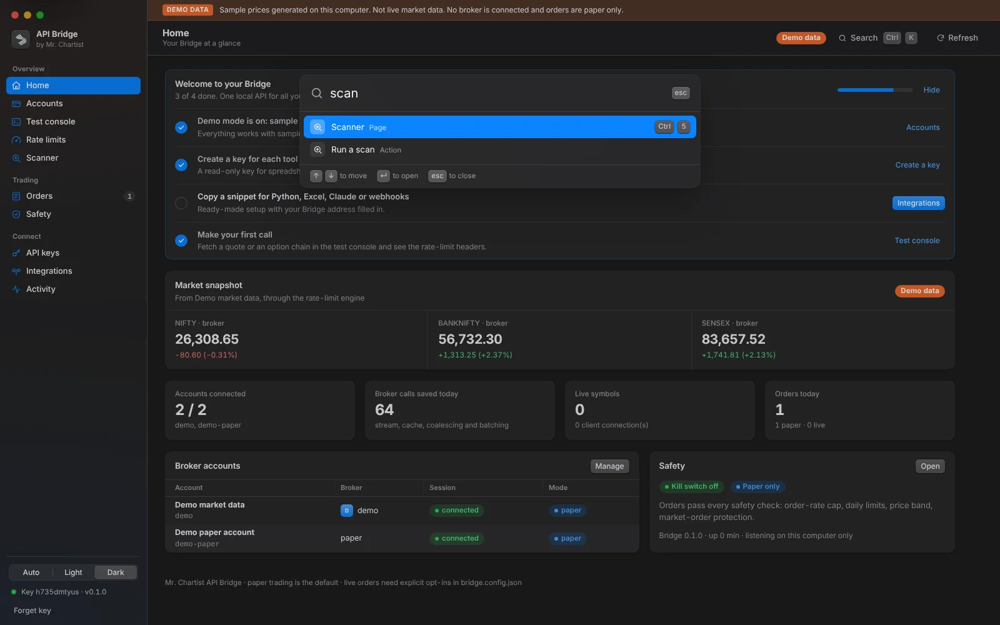
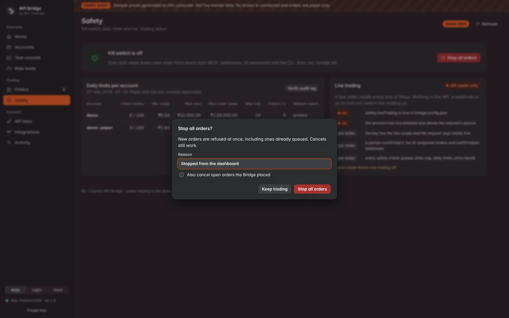
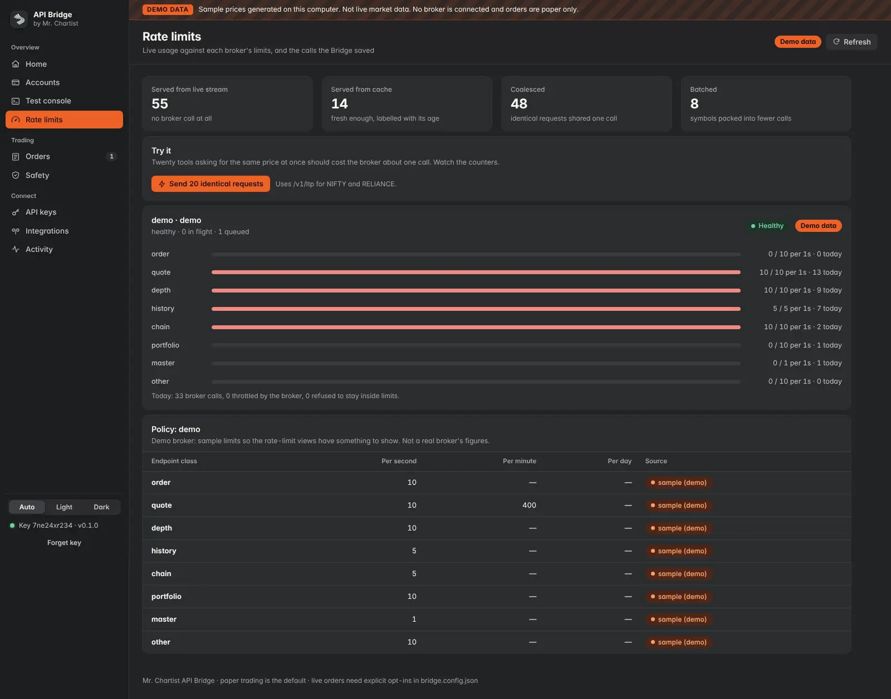
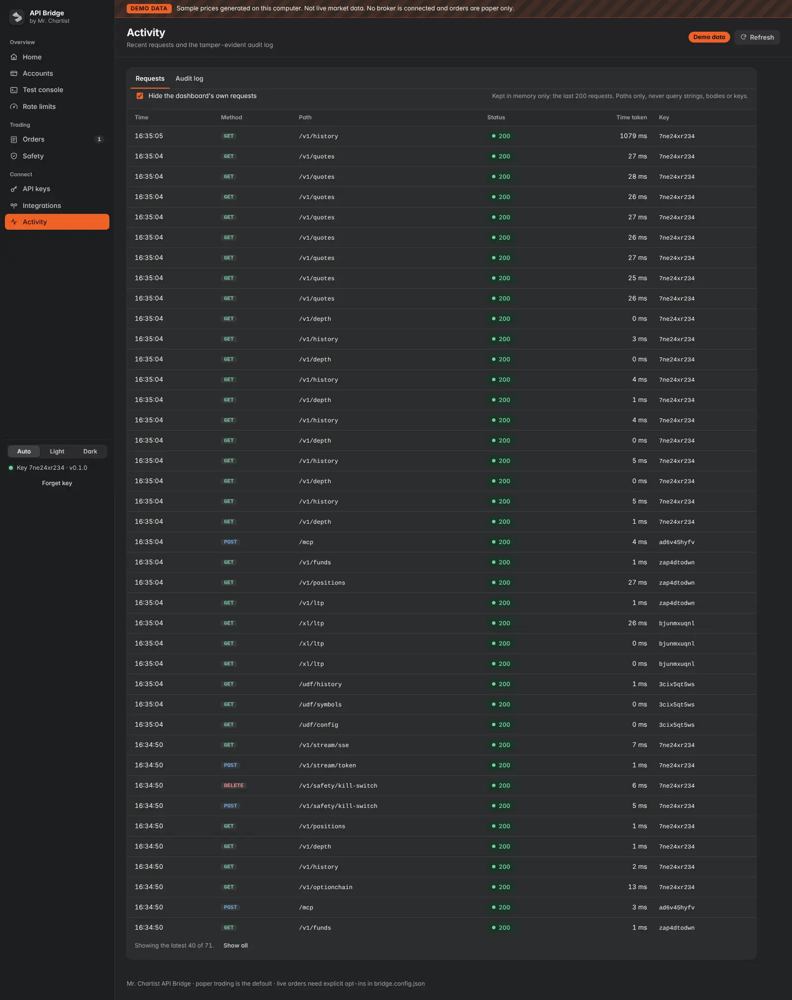
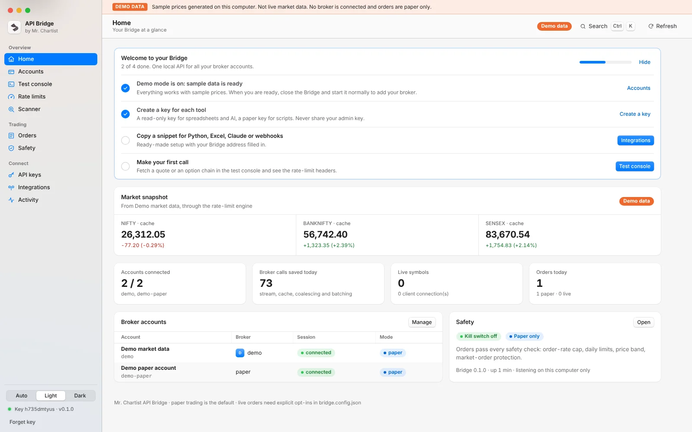
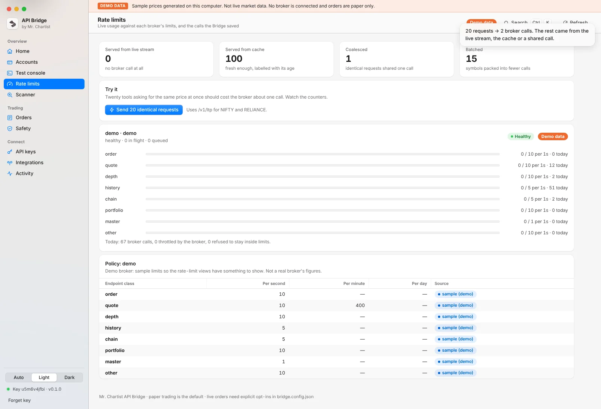
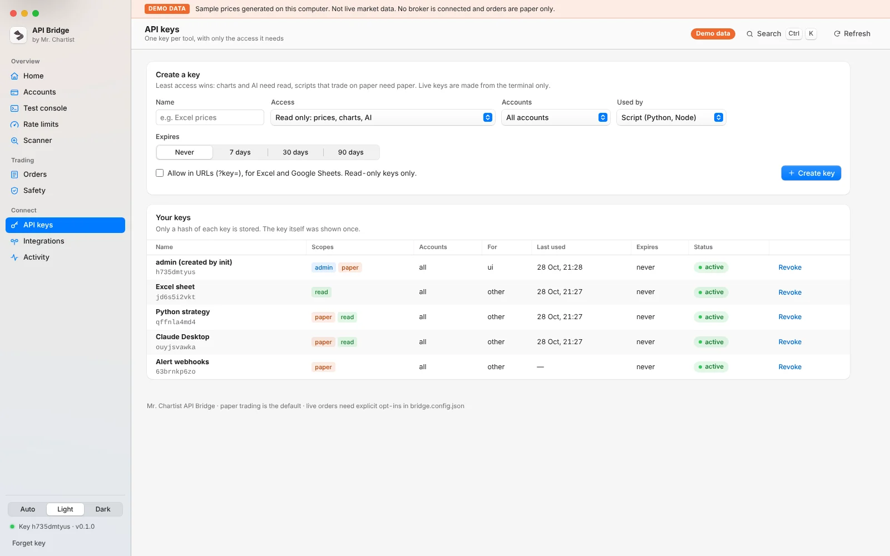
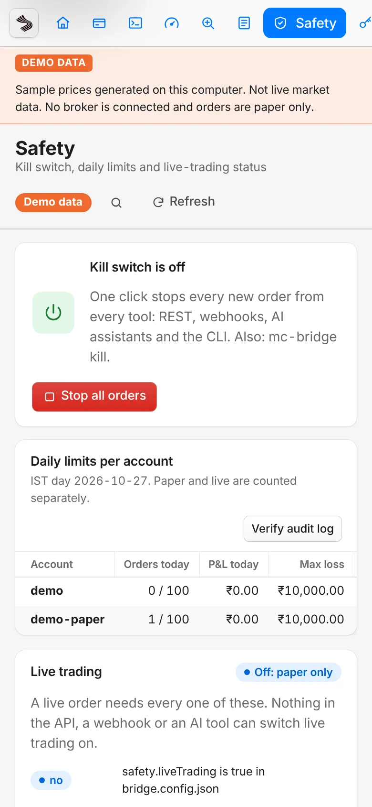

<p align="center">
  
</p>

<h1 align="center">Mr. Chartist API Bridge</h1>

<p align="center"><strong>One local API for all your Indian broker accounts.</strong><br>
Alerts, Excel, Python and AI assistants all share one careful connection to your broker. Free and open source.</p>

<p align="center">
  <a href="https://github.com/MrChartist/api-bridge/actions/workflows/ci.yml"></a>
  <a href="LICENSE"></a>
  
  
  
</p>

<p align="center">
  
</p>

---

## What it does

The Bridge is a small program that runs on **your own computer**. You log in to your broker once, and then every
tool you use gets prices, option chains, candles, positions and (paper) orders from the Bridge instead of each tool
calling the broker on its own:

- **Alerts** from Chartink, GoCharting or your own scripts become paper orders through a webhook.
- **Excel, Google Sheets and AmiBroker** get live prices in cells and formulas.
- **Python and Node** scripts use a simple SDK.
- **Claude, ChatGPT and other AI assistants** can read prices and your positions, and can only *prepare* orders that
  you confirm yourself.

Why bother? Broker APIs allow only a few requests a second. Ten tools each polling the broker get you blocked. The
Bridge answers from its live stream and cache first, shares identical requests, batches symbols and keeps every
account inside its broker's limits, so your broker sees **one well-behaved client**.

It is **safe by default**: it listens on `127.0.0.1` only, every order is a **paper** order unless you switch live
trading on in the config file, every tool gets its own scoped key, and there is a one-click kill switch.

> **Use at your own risk.** This is not investment advice, and the authors are not responsible for any trading loss.
> The Bridge is meant to run on your own machine for your own accounts (and the family members SEBI allows); it is not
> a hosted or shared service. Following SEBI rules and your broker's API terms is your responsibility. See
> [Compliance notes](#compliance-notes).

## Contents

1. [Install in one step](#install-in-one-step) · [Try demo mode](#try-demo-mode)
2. [Connect brokers and several accounts](#connect-brokers-and-several-accounts)
3. [How rate limits are handled](#how-rate-limits-are-handled) · [Spread the work over your accounts](#spread-the-work-over-your-accounts) ·
   [Backup data](#backup-data-when-no-broker-can-answer) · [Scanner](#scanner)
4. [Screenshots](#screenshots)
5. [Integrations](#integrations): alert webhooks · AmiBroker · Excel and Sheets · Python · Node · Claude (MCP) ·
   ChatGPT and OpenAI · REST and streaming · compat `/api/v1` API
6. [Safety model](#safety-model) · [Compliance notes](#compliance-notes)
7. [Supported brokers](#supported-brokers)
8. [Troubleshooting](#troubleshooting) · [FAQ](#faq) · [Commands and configuration](#commands-and-configuration)
9. [Contributing](#contributing) · [Roadmap](ROADMAP.md) · [License](#license)

---

## Install in one step

No programming needed, no admin password, and nothing else to install first: the Bridge brings its own Node.js when
your computer does not have it. When it finishes, the dashboard opens in your browser **already signed in**.
Step-by-step guide, with what to click on each system: **[docs/guides/install.md](docs/guides/install.md)**.

**Windows 10 / 11**: download **`Mr-Chartist-Bridge-Setup-….exe`** from the
[latest release](https://github.com/MrChartist/api-bridge/releases/latest) and double-click it. Or open
**PowerShell** (Start → type *PowerShell*), paste this line and press Enter:

```powershell
irm https://raw.githubusercontent.com/MrChartist/api-bridge/master/install.ps1 | iex
```

**Mac or Linux**: open **Terminal**, paste this line and press Enter:

```sh
curl -fsSL https://raw.githubusercontent.com/MrChartist/api-bridge/master/install.sh | sh
```

Afterwards, start it like any app: **Mr Chartist Bridge** in the Start menu or on the Desktop (Windows), in
Spotlight or Launchpad (Mac), or in your applications menu (Linux). Run the same line again to update; your settings
are kept.

**Android phone or tablet**: the same line works inside the free **Termux** app; see
[Android (Termux)](docs/guides/install.md#android-termux).

**Prefer a download?** Each [release](https://github.com/MrChartist/api-bridge/releases/latest) has a ready-to-run
ZIP per system with everything inside. Unzip it and double-click `start-windows.bat`, `start-mac.command` or
`start-linux.sh`. The [install guide](docs/guides/install.md#ready-to-run-download) covers the one-time Windows and
macOS security prompt.

### Docker

1. In the repository folder: `docker compose up -d`
2. `docker compose logs bridge` shows your **admin key** (printed once, on the first start).
3. Open <http://127.0.0.1:4300/dashboard> and paste the key. The port is published on `127.0.0.1` only. Data and the
   master key live in two separate volumes (`bridge-data`, `bridge-secrets`). For demo mode set `MCB_DEMO: "1"` in
   `docker-compose.yml`.
4. The first admin key is now in the container log: make a new admin key on the **API keys** page and revoke the
   first one.

`docker compose` with the provided `docker-compose.yml` is the supported way to run the Bridge in Docker: it keeps the
port on `127.0.0.1`, the filesystem read-only and the master key in its own volume. A plain `docker run -p 4300:4300`
publishes the Bridge to your whole network.

### Public demo on a server (Hostinger VPS)

Want a demo others can open at your own domain? `deploy/hostinger` runs the Bridge in **demo mode** behind Caddy
(automatic HTTPS) with Docker: `DOMAIN=bridge.yourdomain.com docker compose up -d --build`. Step-by-step:
[deploy/hostinger/README.md](deploy/hostinger/README.md). Never put real broker accounts on a public server.

### Developers

```bash
git clone https://github.com/MrChartist/api-bridge.git && cd api-bridge
npm ci
npx mc-bridge init          # config, master key (outside the data folder) and your first admin key
npm start -- --demo --open  # sample data, no broker needed; drop --demo for your real accounts
```

Run `npx mc-bridge ...` (or `npm run bridge -- ...`) **inside the `api-bridge` folder**: there npx uses this
project's own command. Outside it, npx would download an unrelated public package with the same name. `npm link`
once gives you a global `mc-bridge` command.

`mc-bridge init` also works without questions: `npx mc-bridge init --yes --broker dhan` (flags: `--demo`,
`--account <id>`, `--label <text>`, `--no-paper`, `--force`). It never asks for broker passwords or keys; you type those
later with `mc-bridge accounts connect`, straight into the encrypted store.

Check your setup at any time:

```bash
npm run bridge -- doctor
```

```text
OK    node           Node.js 22.22.0
OK    config         Loaded /home/me/api-bridge/bridge.config.json
OK    bind           Listening address 127.0.0.1:4300 (this computer only)
OK    data-dir       /home/me/api-bridge/data is writable
OK    master-key     Key file /home/me/.config/mc-bridge/master.key
OK    live-trading   Live trading is off (paper only)
OK    accounts       2 account(s): paper (paper), dhan-main (dhan)
OK    api-keys       1 active key(s)
WARN  market-data    No market-data source connected (log in dhan-main). ... or try everything with sample data: npm start -- --demo
```

## Try demo mode

```bash
npm start -- --demo --open
```

Demo mode lets you try **everything** with no broker account: the dashboard, the test console, Excel,
Python, Node, webhooks and AI tools. A built-in sample market gives repeatable quotes, depth, option chains with
Greeks, candles and a live tick stream for **NIFTY, BANKNIFTY, SENSEX** and RELIANCE, HDFCBANK, ICICIBANK, INFY,
TCS and SBIN, plus a paper account with ₹10,00,000 of practice money.

It can never be mistaken for the real thing:

- every page of the dashboard shows a **DEMO DATA** banner, and the terminal prints a demo banner at start;
- every HTTP response carries `X-MCB-Data: demo`; JSON answers add `"meta": { "demo": true, "dataNotice": "..." }`;
  `/v1/health` says `"demo": true`; AI tool results start with "DEMO DATA";
- instrument names end in "(Demo)" (for example "NIFTY 50 (Demo)");
- **no real broker is loaded at all**, live trading is forced off, orders go to the `demo-paper` account, and no broker
  secret or master key is read or written.

You can also set `"demo": true` in `bridge.config.json` or `MCB_DEMO=1` in the environment. The screenshots in this
README were taken in demo mode.

---

## Connect brokers and several accounts

**The easy way:** on the dashboard open **Accounts → Add a broker**, pick your broker, then fill in the **Log in**
form it opens. That is all; no file to edit, no terminal, no restart. New accounts are paper (practice) only. Each
morning when a broker ends its session, click **Log in again** on the same page.

The rest of this section is for people who prefer files and the terminal.

### 1. List your accounts in `bridge.config.json`

`mc-bridge init` writes this file for you, and the dashboard's **Add a broker** adds to it. By hand it looks like this:

```json
{
  "accounts": [
    { "id": "dhan-main",      "broker": "dhan",    "label": "Dhan (main)",      "holder": "self" },
    { "id": "zerodha-main",   "broker": "zerodha", "label": "Zerodha (main)",   "holder": "self" },
    { "id": "zerodha-spouse", "broker": "zerodha", "label": "Zerodha (spouse)", "holder": "spouse" },
    { "id": "paper",          "broker": "paper",   "label": "Practice account" }
  ]
}
```

- `id` is your own short name (lowercase letters, digits, hyphens). `broker` is an id from
  [Supported brokers](#supported-brokers), or `paper` for the built-in simulator.
- Several brokers and several accounts at the same broker work side by side, each with its own session and limits.
- `holder` says whose account it is (`self`, `spouse` ...; never a PAN). Reads are only ever spread over accounts of
  the **same** holder, and only when you switch it on (see [Spread the work over your accounts](#spread-the-work-over-your-accounts)).
- **No password, PIN or API secret ever goes in this file.**

### 2. Log in each account

With the Bridge running, in a second terminal in the same folder:

```bash
npm run bridge -- accounts connect dhan-main --key <your admin key>
```

It asks for each field your broker needs. What you type is hidden and goes only to the Bridge on this computer,
which keeps it encrypted (AES-256-GCM). PINs, passwords and TOTP codes are used once to log in and **never stored**.
Most brokers end API sessions every morning: run the command again then, or click **Log in again** on the
dashboard's **Accounts** page, which shows each session's state.

Full guide: [docs/guides/accounts.md](docs/guides/accounts.md).

### 3. Use them

- Pin a read or an order to one account with `account=<id>` (query) or `"account": "<id>"` (order body).
- Without `account`, market data comes from your first connected account that can serve it.
- Keys can be limited to some accounts: `--accounts dhan-main,paper`.

---

## How rate limits are handled


Every request goes through the same pipeline, so the broker only sees what is really needed:

1. **Live stream first.** If any tool streams a symbol, reads of it are answered from the latest tick: no broker call.
2. **Cache with honest labels.** Recent values are reused within a short freshness target (LTP 1 s, quote 2 s,
   depth 1 s, chain 3 s). Every value says where it came from and how old it is:
   `"freshness": { "source": "stream" | "cache" | "broker" | "paper" | "backup", "ageMs": 420, "stale": false, ... }`.
3. **Sharing and batching.** Twenty tools asking for the same price at once cause **one** broker call; symbols from
   many requests are packed into each broker's documented batch size.
4. **Budgets per account and per kind of call** (orders, quotes, depth, history, chains, portfolio, instrument
   masters), with per-second, per-minute and per-day windows taken from each broker's documentation. Where a broker
   publishes no limit, conservative defaults apply (1 request a second for quotes, depth, history and chains; 2 for
   portfolio; 5 for orders). Your config can only **lower** them.
5. **Orders first.** Orders jump the queue ahead of reads; background work still finishes.
6. **No silent drops.** A symbol that could not be fetched in time comes back in `errors[]` with
   `UPSTREAM_RATE_LIMITED` and `retryAfterMs`; an older value is only served labelled `"stale": true`.

See it live on the dashboard's **Rate limits** page (with a "send 20 identical requests" button), or via
`GET /v1/usage` and `GET /v1/limits`. Each number in the policy table has a source link and a `verified` flag:
[server/bridge/ratelimit/brokerPolicies.mjs](server/bridge/ratelimit/brokerPolicies.mjs). Guide:
[docs/guides/rate-limits.md](docs/guides/rate-limits.md).

### Spread the work over your accounts

Have Dhan and Zerodha (or two Dhan accounts) in your own name? Let read-only market data use the budgets of all of
them:

```json
{ "id": "dhan-main", "broker": "dhan",    "holder": "self", "marketData": { "pooling": true, "poolingWhenTermsUnknown": true } },
{ "id": "kite-main", "broker": "zerodha", "holder": "self", "marketData": { "pooling": true, "poolingWhenTermsUnknown": true } }
```

A 200-symbol quote request is then cut into each broker's batch size and shared out to whichever account has the
most budget left; scans run one worker pool per account. Every account still stays inside its own broker's limits,
credentials never move between accounts, orders and portfolio reads are never pooled, and accounts of different
people are never mixed. Brokers' terms on this are not confirmed, so it is your choice, made in the config file only.

### Backup data when no broker can answer

Turn on `"backup": { "enabled": true }` (new installs have it) and a read that no broker account can answer
(none connected, session expired before you logged in, broker down, budget gone) is answered from **Yahoo Finance**
or the **NSE website** instead of failing: stock and index quotes and candles, NSE option chains and expiries. Every
such value says so: `"freshness": { "source": "backup", "provider": "yahoo", "asOf": ... }`. Backup prices are never
used for orders, paper fills or safety checks. Guide: [docs/guides/backup-data.md](docs/guides/backup-data.md).

### Scanner

Scan the whole F&O list, NIFTY 50 or your own watchlist with a readable condition:

```bash
curl -X POST -H "Authorization: Bearer $KEY" -H "content-type: application/json" "http://127.0.0.1:4300/v1/scanner/jobs?waitMs=60000" \
  -d '{ "universe": "FNO", "condition": "close crosses above ema(20) and rsi(14) > 55", "columns": ["rsi(14)"], "sort": { "by": "rsi(14)" } }'
```

Indicators: SMA, EMA, WMA, RSI, MACD, ATR, Bollinger, Supertrend, VWAP, highest/lowest, `crosses above/below`,
`x[k]` for past bars. Scans run at background priority (charts and orders always go first), are shared out over
your pooled accounts, fall back to backup candles, and can be saved to run every few minutes with an alert on the
WebSocket when new symbols match. Guide: [docs/guides/scanner.md](docs/guides/scanner.md).

Option analytics (OI, gamma exposure, skew, futures basis, strategy payoff and more): [docs/guides/analytics.md](docs/guides/analytics.md).

 60 and close > sma(50), 50 of 50 symbols scanned, 13 matches sorted by RSI" width="820">

### Alerts on your phone

Saved-scan hits, live fills, the kill switch and expired broker sessions can go to **Telegram**, **Discord**,
**Slack** or a signed **webhook** (n8n, Zapier, your own code). Tokens and webhook URLs stay in environment
variables, never in the config file. Guide: [docs/guides/notifications.md](docs/guides/notifications.md).

---

## Screenshots

All taken in demo mode, styled after macOS: a translucent sidebar, a unified toolbar, sheets that slide down from it,
system blue, light and dark themes, and Motion animations that switch off when your system asks for reduced motion.
Press <kbd>⌘K</kbd> / <kbd>Ctrl K</kbd> anywhere to jump to a page or action. The full gallery with descriptions is in
[docs/screenshots](docs/screenshots/README.md); `node scripts/capture-screenshots.mjs` regenerates every image.

| | |
|---|---|
| <br>**Scanner**: a whole universe, shared over your accounts | <br>**AI tickets**: nothing is sent until you confirm |
| <br>**Command palette**: every page and action from the keyboard | <br>**Kill switch**: one click stops every order |
| <br>**Accounts** and the 41-broker directory | <br>**Test console** with a live response |
| <br>**Rate limits**: live budgets and calls saved | <br>**Orders**: AI tickets wait for you |
| <br>**Integrations**: copy-paste setup per tool | <br>**Safety**: kill switch and daily limits |
| <br>**API keys** with scopes | <br>**Activity**: request and audit logs |

<details>
<summary><strong>Light theme</strong></summary>

| | |
|---|---|
|  |  |
|  |  |
|  |  |
|  |  |
|  |  |

</details>

<details>
<summary><strong>Phone</strong></summary>

| | | | | |
|---|---|---|---|---|
|  |  |  |  |  |

</details>

---

## Integrations

Make **one key per tool** with the least access it needs (dashboard → **API keys**, or the **Create a key for this**
button on each Integrations tab). `read` is enough for Excel and AI; scripts that place paper orders need
`paper`. All examples use the default address `http://127.0.0.1:4300`. In demo mode the paper account is called
`demo-paper`, so use `"account": "demo-paper"` wherever an example says `"account": "paper"`.

```bash
npm run bridge -- keys create --label ai      --scope read
npm run bridge -- keys create --label scripts --scope paper
npm run bridge -- keys create --label excel   --scope read --allow-query --client excel --expires 90d   # key goes in URLs
```

### Alert webhooks (Chartink, GoCharting, your own scripts)

Create a hook on the dashboard (**Integrations → Webhooks → Create webhook**) or with an admin key:

```bash
curl -X POST http://127.0.0.1:4300/v1/hooks -H "Authorization: Bearer $MCB_ADMIN_KEY" -H "Content-Type: application/json" \
  -d '{"source":"generic","label":"My strategy","account":"paper","product":"MARGIN","orderType":"LIMIT","maxLotsPerSignal":2}'
```

The answer contains the hook's **URL, which carries its own 256-bit secret token** (`/hooks/<source>/<token>`), and,
for `generic` hooks, the signing secret. Both are shown **once**; only hashes are stored. In demo mode use
`"account": "demo-paper"`.

| Source | What it sends |
|---|---|
| `generic` | Your own scripts and tools. JSON such as `{"symbol":"NSE:RELIANCE","side":"BUY","quantity":10,"price":1402.5,"id":"sig-42"}`, signed with `X-MCB-Signature: t=<unix seconds>,v1=<HMAC-SHA256>`. |
| `chartink` | Chartink scan alerts. The hook's `side` decides buy or sell; each listed stock becomes one signal. |
| `gocharting` | GoCharting alerts with a text message such as `BUY NSE:RELIANCE 10 @ 1402.5`. |

- An `id` on a signal makes a repeated delivery place one order, not two.
- Hooks place **paper** orders unless created as live, which needs live trading switched on for the account, the
  `live` scope, and a signature, an IP allowlist or your confirmation.
- Chartink and GoCharting post only to public HTTPS, so point a tunnel (for example Cloudflare Tunnel) at the opt-in
  public listener, which serves `/hooks/*` and nothing else: `"server": { "publicIngress": { "enabled": true } }`.

Guide: [docs/guides/webhooks.md](docs/guides/webhooks.md).

### AmiBroker (AFL)

Copy [integrations/amibroker/mrchartist-bridge.afl](integrations/amibroker/mrchartist-bridge.afl) to
`Formulas\Include`, set the key once (`setx MCB_AMIBROKER_KEY mcb_YOUR_URL_KEY`, then restart AmiBroker), and:

```c
#include_once <mrchartist-bridge.afl>

ltp = McbLtp("NSE:NIFTY");
chg = McbQuote("NSE:RELIANCE", "changePct");
Title = "NIFTY " + NumToStr(ltp, 1.2) + "   RELIANCE " + NumToStr(chg, 1.2) + "%";
```

History imports use `/xl/history?layout=amibroker` with the shipped `.format` files. Guide:
[docs/guides/amibroker.md](docs/guides/amibroker.md).

### Excel and Google Sheets

Excel for Windows, one live value per cell. Put a read-only URL key (`--allow-query`) in a cell named `BridgeKey`:

```
=VALUE(WEBSERVICE("http://127.0.0.1:4300/xl/ltp?symbol="&ENCODEURL(A2)&"&key="&BridgeKey))
=VALUE(WEBSERVICE("http://127.0.0.1:4300/xl/quote?symbol="&ENCODEURL(A2)&"&field=changePct&key="&BridgeKey))
```

Errors come back as `#N/A` (so `IFERROR` works). Power Query tables for option chains and candles are in
[integrations/excel](integrations/excel). Google Sheets runs on Google's servers, so it needs your own tunnel; then
`=BRIDGE_LTP("NSE:NIFTY")` from [integrations/google-sheets/bridge.gs](integrations/google-sheets/bridge.gs). Nothing
under `/xl` can place an order. Guide: [docs/guides/excel-sheets.md](docs/guides/excel-sheets.md).

### Python

```bash
python3 -m venv .venv && . .venv/bin/activate      # Windows: py -m venv .venv ; .venv\Scripts\Activate.ps1
pip install ./sdk/python                            # standard library only, Python 3.9+
export MCB_API_KEY=mcb_YOUR_PAPER_KEY               # PowerShell: $env:MCB_API_KEY = "mcb_..."
```

```python
from mrchartist_bridge import BridgeClient

bridge = BridgeClient()                                  # http://127.0.0.1:4300, key from $MCB_API_KEY
for q in bridge.ltp(["NSE:NIFTY", "NSE:RELIANCE"])["data"]:
    print(q["symbol"], q["ltp"], q["freshness"]["source"])

res = bridge.place_order({"account": "paper", "symbol": "NSE:RELIANCE", "side": "BUY",
                          "quantity": 1, "product": "CNC", "orderType": "MARKET"})   # paper; Idempotency-Key added for you
print(res["data"]["orderId"], res["data"]["status"])

with bridge.stream(["NSE:NIFTY"], mode="ltp") as s:     # reconnects and re-subscribes by itself
    for msg in s:
        if msg["type"] == "tick":
            print(msg["symbol"], msg["ltp"])
```

In demo mode use `"account": "demo-paper"`. Guide: [sdk/python/README.md](sdk/python/README.md).

### Node / TypeScript

```bash
cd sdk/node && npm pack            # then in your project: npm install /path/to/mrchartist-bridge-client-0.1.0.tgz ws
```

```ts
import { BridgeClient } from "@mrchartist/bridge-client";

const bridge = new BridgeClient({ apiKey: process.env.MCB_API_KEY! });
const { data, errors } = await bridge.ltp(["NSE:NIFTY", "NSE:RELIANCE"]);   // partial failures land in errors[]
for (const q of data) console.log(q.symbol, q.ltp, q.freshness.source);

const { data: order } = await bridge.placeOrder({ account: "paper", symbol: "NSE:RELIANCE", side: "BUY", quantity: 1, product: "CNC", orderType: "MARKET" });

const stream = bridge.stream({ symbols: ["NSE:NIFTY"], mode: "ltp" });
stream.on("tick", (t) => console.log(t.symbol, t.ltp));
```

ESM only, types included, no runtime dependencies (streaming on Node 20 needs `ws`). Guide:
[sdk/node/README.md](sdk/node/README.md).

### Claude Desktop and Claude Code (MCP)

The Bridge is an MCP server. Use a **read** key. Keep the Bridge running; if the AI app starts first, the tools
appear as soon as the Bridge is up.

**Claude Desktop** (`claude_desktop_config.json`):

```json
{
  "mcpServers": {
    "mr-chartist-bridge": {
      "command": "node",
      "args": ["/path/to/api-bridge/bin/mc-bridge.mjs", "mcp"],
      "env": { "MCB_API_KEY": "mcb_YOUR_READ_KEY", "MCB_BRIDGE_URL": "http://127.0.0.1:4300" }
    }
  }
}
```

**Claude Code**:

```bash
claude mcp add mr-chartist-bridge --env MCB_API_KEY=mcb_YOUR_READ_KEY --env MCB_BRIDGE_URL=http://127.0.0.1:4300 -- node /path/to/api-bridge/bin/mc-bridge.mjs mcp
# or over HTTP:
claude mcp add --transport http mr-chartist-bridge http://127.0.0.1:4300/mcp --header "Authorization: Bearer mcb_YOUR_READ_KEY"
```

Tools: `get_ltp`, `get_quotes`, `get_depth`, `get_history`, `get_expiries`, `get_option_chain`, `search_instruments`,
`convert_symbol`, `option_chain_summary`, `history_summary`, `scan_market`, `list_accounts`, `get_positions`, `get_holdings`,
`get_funds`, `list_orders`, `get_order`, `get_safety_status`. Order tools appear only if you turn them on
(`mcp.toolsets` with `"orders"`, `mcp.orderAccounts`, a `paper` key), and even then the AI only **prepares** a
ticket: nothing is sent until you confirm it on the dashboard's **Orders** page. Guide:
[docs/guides/mcp.md](docs/guides/mcp.md).

### ChatGPT and OpenAI (tool schemas)

ChatGPT's connectors call MCP servers over the public internet, and the Bridge keeps `/mcp` on this computer, so a
ChatGPT connector cannot reach it out of the box (ChatGPT's current options for local servers **need verification**).
For OpenAI function calling from your own script, export the same tools as strict OpenAI schemas:

```bash
npm run -s bridge -- openai-tools > tools.json                 # Responses API
npm run -s bridge -- openai-tools --format chat > tools.json   # Chat Completions
```

Your script then runs each tool call against `POST /mcp` (JSON-RPC `tools/call`) or the REST API. Do not expose `/mcp`
through a tunnel without your own access control. Guide: [docs/guides/chatgpt-openai.md](docs/guides/chatgpt-openai.md).

### REST and streaming

```bash
K="Authorization: Bearer $MCB_API_KEY"
curl -H "$K" "http://127.0.0.1:4300/v1/quotes?symbols=NSE:NIFTY,NSE:RELIANCE"
curl -H "$K" "http://127.0.0.1:4300/v1/expiries?underlying=NIFTY"     # pick an expiry from this list
curl -H "$K" "http://127.0.0.1:4300/v1/optionchain?underlying=NIFTY&expiry=<YYYY-MM-DD>&strikes=10&greeks=true"
curl -H "$K" "http://127.0.0.1:4300/v1/history?symbol=NSE:NIFTY&interval=5m&countback=300"
```

One symbol format for every broker: `NSE:RELIANCE`, `NSE:NIFTY`, `NFO:NIFTY-2026-10-27-25000-CE`
(`/v1/symbols/convert` translates broker-specific symbols). Answers are `{ "data", "meta" }`;
errors are `application/problem+json` with a stable `code`. Live prices: WebSocket `ws://127.0.0.1:4300/v1/stream`
or SSE `/v1/stream/sse`, with a single-use token from `POST /v1/stream/token`. Send an `Idempotency-Key` with every
order (required for live orders). Reference: [docs/openapi.yaml](docs/openapi.yaml) (also served at `/openapi.yaml`)
and [docs/guides/streaming.md](docs/guides/streaming.md).

### Compat `/api/v1` API for existing algo tools

Tools and SDKs built for the common Indian-algo REST style (`POST /api/v1/placeorder` with `apikey` in the JSON body,
`{ "status": "success" }` replies, symbols like `NIFTY27OCT2625000CE` / `NFO`) work against the Bridge unchanged:
point them at `http://127.0.0.1:4300` and use a Bridge key. 30 endpoints (orders, smart/basket/split orders, books,
quotes, depth, history, option chain, option symbol by offset) plus a WebSocket at `/api/v1/ws`. Orders are paper
("analyzer mode") until you enable live trading the Bridge way. Guide: [docs/guides/compat-api.md](docs/guides/compat-api.md).

---

## Safety model

| Protection | What it means |
|---|---|
| **Paper by default** | Every order, webhook and AI tool is paper unless you set it up otherwise. Each order says `"mode": "paper"` or `"live"`. |
| **Live needs every opt-in** | (1) `safety.liveTrading: true` and (2) the account's `live.enabled: true` in the config file; (3) the source (`rest`, `webhook`, `mcp`, `cli`) allowed for that account; (4) a key with the `live` scope; (5) `"mode": "live"` on the request; (6) your confirmation for AI-prepared orders; (7) every safety check passing. Nothing in the API, a webhook or an AI tool can switch live trading on. Live orders are wired for Dhan (verified), Zerodha and Upstox (beta, with a warning). |
| **This computer only** | Listens on `127.0.0.1`; host and browser-origin checks block DNS-rebinding tricks; admin and credential routes refuse anything not from this computer. |
| **Scoped keys** | `read` < `paper` < `live`, plus `admin` (which does not include live). Stored only as scrypt hashes, shown once, revocable instantly, optionally limited to some accounts and given an expiry. |
| **Kill switch** | One click on the dashboard, `mc-bridge kill`, or `POST /v1/safety/kill-switch` stops every new order from every tool. Releasing needs an admin key from this computer. |
| **Daily limits** | Orders per day, loss per day, order value, lots per order (for cash, 1 lot = 1 share), a price band around the last price, and an order rate of 5 a second per account (never above 10). |
| **Market orders** | Converted to protected limit orders by default, or refused. |
| **No double orders** | `Idempotency-Key` or `clientOrderId`; a timed-out live order is checked against the broker's order book, never blindly retried. |
| **Encrypted secrets** | Broker keys and sessions are encrypted with AES-256-GCM. `mc-bridge init` keeps the master key in a private file **outside** the data folder (`~/.config/mc-bridge/master.key`, or `%APPDATA%\MrChartist\master.key` restricted with `icacls`). Passwords, PINs and TOTP codes are never stored. |
| **Audit log** | Append-only, hash-chained, one file per IST day in `data/audit/`, with secrets redacted. Verify it from the Safety page. |
| **Clean logs** | No request bodies, keys or tokens in logs; webhook URLs are logged without their secret. |

What the safety model does **not** cover:

- **Programs that can run commands as you.** Anything that can run commands on your computer, including an AI agent
  with shell access, can use the local `mc-bridge` CLI to create keys and confirm its own order tickets. The
  confirmation step protects you from AI tools that only have API access, not from ones that have your terminal.
- **Docker published on all interfaces.** Use the provided `docker-compose.yml`, which publishes the port on
  `127.0.0.1` only. A plain `docker run -p 4300:4300` exposes the Bridge to your network.
- **Keys in logs.** The first admin key is printed once at setup (with Docker, into `docker compose logs`). Create a
  new admin key and revoke the first one once you are set up.

Guide: [docs/guides/safety.md](docs/guides/safety.md).

---

## Compliance notes

**Not legal advice.** Items marked **Needs verification** must be checked against the primary SEBI, NSE and BSE
circulars and your broker's current notices before you rely on them. More detail:
[docs/guides/compliance.md](docs/guides/compliance.md).

- **SEBI/NSE retail algo framework.** SEBI's circular on safer participation of retail investors in algorithmic
  trading (SEBI/HO/MIRSD/MIRSD-PoD/P/CIR/2025/0000013, 4 February 2025) and NSE's implementation standards
  **NSE/INVG/67858** (5 May 2025), **mandatory from 1 April 2026** after extensions. **Needs verification:** the
  effective date and any later changes.
- **10 orders per second.** An algo that is not registered with the exchange must stay at or below **10 orders a
  second per exchange segment**, as your broker measures it. The Bridge caps each account at 5 a second by default and
  never allows more than 10. **Needs verification** per broker: whether modifications and cancellations count, and
  whether the limit is per client, per PAN or per segment.
- **Static IP for API orders.** Brokers must accept API orders only from a static IP you registered with them. A home
  connection with a changing IP, or a tunnel to one, cannot place live orders. Set `live.registeredIp` per account for
  a warning before each order. **Needs verification** against your broker's process.
- **No open APIs.** API access must be tied to you through your own API key (and static IP); brokers may not offer
  "open" APIs that anyone can use. The Bridge therefore uses only your own keys, never shares a session between
  people, and binds to this computer. Do not expose the main API to others.
- **Personal use of your own accounts only.** Use it for your own accounts (and, as SEBI allows, your spouse,
  dependent children and dependent parents; **Needs verification:** the exact family definition). Running it for
  anyone else, hosting it, or selling signals or strategies would likely need exchange empanelment as an algo provider
  (legal review needed).
- **Daily logout.** API sessions end before the next trading day; the Bridge never stores TOTP secrets or automates
  2FA. **Needs verification** per broker.
- **AI-placed orders.** No regulator guidance covers AI agents placing orders; an AI order through your key is still
  your API order. Hence read-only AI by default and your confirmation for every AI order.
- **Market data terms.** Broker data is generally for personal use. Opening a tunnel to the main API (for example
  for Google Sheets) passes your broker's data through third-party servers, which your broker's terms may not allow
  (**Needs verification** per broker).

---

## Supported brokers

**41 Indian brokers** through one tested adapter contract. **Dhan** is verified end to end with a live account. All
others are **Beta**: written from the broker's official documentation and tested against recorded sample responses,
but not yet checked with a live account, so compare numbers with your broker before you rely on them. Capabilities,
sign-in details and notes per broker: **[docs/BROKERS.md](docs/BROKERS.md)**.

<details>
<summary><strong>All 41 brokers</strong></summary>

| Broker | id | Sign-in | Status |
|---|---|---|---|
| 5paisa | `fivepaisa` | Session login (PIN + TOTP) | Beta |
| 5paisa (XTS) | `fivepaisaxts` | API key / token | Beta |
| Alice Blue | `aliceblue` | One-time code | Beta |
| Anand Rathi (Algozy, XTS) | `anandrathi` | API key / token | Beta |
| Angel One (SmartAPI) | `angelone` | Session login (PIN + TOTP) | Beta |
| Arrow | `arrow` | One-time code | Beta |
| Axis Direct (RAPID APIs) | `axisdirect` | One-time code | Beta |
| Bigul (Bigul Connect) | `bigul` | Session login (PIN + TOTP) | Beta |
| Composite Edge (XTS) | `compositedge` | One-time code | Beta |
| Definedge Securities (INTEGRATE) | `definedge` | Session login (PIN + TOTP) | Beta |
| Dhan | `dhan` | API key / token | Verified |
| Firstock | `firstock` | Session login (PIN + TOTP) | Beta |
| Flattrade (Pi) | `flattrade` | One-time code | Beta |
| Fyers | `fyers` | OAuth login | Beta |
| Goodwill (GWC) | `goodwill` | One-time code | Beta |
| Groww | `groww` | API key / token | Beta |
| HDFC Securities (InvestRight) | `hdfcsecurities` | API key / token | Beta |
| HDFC Sky (HDFC Securities) | `hdfcsky` | API key / token | Beta |
| ICICI Direct (Breeze) | `icicidirect` | One-time code | Beta |
| IIFL Capital | `iiflcapital` | One-time code | Beta |
| IIFL Securities (XTS) | `iifl` | One-time code | Beta |
| IndiaBulls Securities (XTS) | `ibulls` | API key / token | Beta |
| IndMoney (INDstocks) | `indmoney` | Session login (PIN + TOTP) | Beta |
| Jainam (XTS) | `jainamxts` | API key / token | Beta |
| Kotak Securities (Neo) | `kotak` | Session login (PIN + TOTP) | Beta |
| Motilal Oswal | `motilal` | Session login (PIN + TOTP) | Beta |
| mStock (Mirae Asset) | `mstock` | Session login (PIN + TOTP) | Beta |
| Nuvama Nubra | `nubra` | Session login (PIN + TOTP) | Beta |
| Paytm Money | `paytm` | API key / token | Beta |
| Pocketful | `pocketful` | API key / token | Beta |
| Profitmart (ProfitMax API) | `profitmart` | One-time code | Beta |
| RMoney (XTS) | `rmoney` | API key / token | Beta |
| Rupeezy (Vortex) | `rupeezy` | One-time code | Beta |
| SAMCO Securities (StockNote) | `samco` | API key / token | Beta |
| Shoonya (Finvasia) | `shoonya` | One-time code | Beta |
| Tradejini (CubePlus) | `tradejini` | Session login (PIN + TOTP) | Beta |
| TradeSmart (Noren v2) | `tradesmart` | One-time code | Beta |
| Upstox | `upstox` | OAuth login | Beta |
| Wisdom Capital (XTS) | `wisdom` | API key / token | Beta |
| Zebu (Mynt) | `zebu` | One-time code | Beta |
| Zerodha (Kite) | `zerodha` | OAuth login | Beta |

</details>

---

## Troubleshooting

| Problem | What to do |
|---|---|
| The dashboard says **"That key was not accepted"** | The key is mistyped, expired or revoked. Make a new one: `npm run bridge -- keys create --label me --scope admin,paper`. |
| Every quote says **BROKER_UNAVAILABLE** or "no broker instrument master is loaded yet" | No broker account is logged in. Run `npm run bridge -- accounts connect <id>`, or try demo mode: `npm start -- --demo`. |
| **SESSION_EXPIRED** in the morning | Brokers end API sessions daily. Log in again with `accounts connect`. |
| **Port 4300 is in use** | The Bridge is already running, or another program uses the port. Stop it, or set `"server": { "port": 4310 }` (or `MCB_PORT=4310`). |
| `keys create` made a key the running Bridge does not know | The CLI and the Bridge used different config files. Run commands from the folder with `bridge.config.json`, or pass `--config`. |
| Windows says Node is not installed | Install the LTS version from <https://nodejs.org/>, then double-click `start-windows.bat` again. |
| macOS will not open `start-mac.command` | Right-click it, choose **Open**, then **Open** again. |
| `pip install` fails with "externally-managed-environment" | Use a virtual environment first (see [Python](#python)). |
| Excel cells show `#N/A` everywhere | The key was created without `--allow-query`, or the symbol is wrong; check the `X-Error-Code` header. |
| `doctor` warns that the master key is in the data folder | Set `masterKeyFile` in `bridge.config.json` (or `MCB_MASTER_KEY_FILE`) to a private file outside the folder and move the key there. Never delete an existing master key: saved broker keys cannot be read without it. |

## FAQ

**Is my money at risk?** Not by default. Every order is paper until you switch live trading on in the config file
and use a key with the `live` scope, and the kill switch stops everything.

**Does my broker key leave my computer?** It goes only from the Bridge to your broker, over HTTPS. Nothing is sent
anywhere else, and there is no cloud service.

**Do I need to know programming?** No. Download, double-click the start file, paste the key into the dashboard, and use
the Integrations page to copy setup for Excel, AmiBroker, webhooks or Claude.

**Can I use two brokers, or my spouse's account?** Yes. List each account in `bridge.config.json` with its own `holder`.
Each account keeps its own session and limits.

**Which broker should I start with?** Dhan is verified with a live account. The other 40 are beta: they should work,
but please compare figures and report what you find.

**Can I run it on a server or VPS?** It is designed for your own computer. On a VPS with a static IP it can meet the
static-IP rule for live orders, but keep it bound to `127.0.0.1` and reach it through SSH, never a public port.

**Can ChatGPT place trades?** No. AI tools are read-only by default, and when order tools are switched on they can
only prepare a ticket that you confirm yourself.

## Commands and configuration

| Command | What it does |
|---|---|
| `mc-bridge init [--yes] [--demo] [--broker <id>]` | First-run setup (alias `setup`) |
| `mc-bridge start [--demo] [--open] [--config <file>]` | Runs the Bridge: REST, WebSocket/SSE, `/xl`, webhooks, MCP and the dashboard |
| `mc-bridge doctor [--no-port-check] [--json]` | Checks Node, config, data folder, master key, keys, accounts and the port |
| `mc-bridge keys create --label <name> --scope read[,paper,live,admin] [--accounts a,b] [--expires 30d] [--allow-query] [--client excel]` | New API key (shown once) |
| `mc-bridge keys list` / `keys revoke <keyId>` | Manage keys |
| `mc-bridge accounts list` / `accounts connect <id> [--key <admin key>]` | Accounts and logging in |
| `mc-bridge kill [--reason "..."] [--cancel-open] [--key <key>]` / `kill release [--key <admin key>]` | Kill switch from the terminal. On the computer running the Bridge no key is needed (it uses a control token the Bridge keeps in its data folder); elsewhere pass `--key` or set `MCB_API_KEY` |
| `mc-bridge mcp --key <key> [--url <bridge url>]` | MCP over stdio for Claude Desktop, Claude Code, Cursor |
| `mc-bridge openai-tools [--scope read\|paper] [--format responses\|chat]` | Tool schemas for OpenAI function calling |

Use them as `npx mc-bridge <command>` or `npm run bridge -- <command>` inside the folder.

The config file is `--config`, else `MCB_CONFIG`, else `./bridge.config.json`, else the per-user folder
(`~/.mc-bridge`, or `%APPDATA%\MrChartist\Bridge` on Windows; `MCB_HOME` moves it).
[bridge.config.example.json](bridge.config.example.json) shows every section; unknown sections are errors, so typos
are caught at start. Core settings: `server`, `cors`, `dataDir`, `masterKeyFile`, `demo`, `logging`, `accounts`,
`safety`; modules: `ratelimit`, `symbols`, `market`, `stream`, `orders`, `paper`, `integrations`, `hooks`, `mcp`.

| Variable | Effect |
|---|---|
| `MCB_CONFIG`, `MCB_HOME` | Config file, per-user folder |
| `MCB_HOST`, `MCB_PORT`, `MCB_DATA_DIR`, `MCB_LOG_LEVEL` | Listener, data folder, log level |
| `MCB_MASTER_KEY` / `MCB_MASTER_KEY_FILE` | Master key (base64 of 32 bytes) or its file |
| `MCB_DEMO=1` | Demo mode |
| `MCB_PAPER_ONLY=1`, `MCB_KILL_SWITCH=1` | Force paper only; engage the kill switch at start (can only tighten) |
| `MCB_API_KEY`, `MCB_BRIDGE_URL` | Key and address for `mc-bridge mcp`, `mc-bridge kill` and the SDKs |

Design and contracts: [docs/ARCHITECTURE.md](docs/ARCHITECTURE.md), [docs/openapi.yaml](docs/openapi.yaml),
[docs/asyncapi.yaml](docs/asyncapi.yaml), guides in [docs/guides](docs/guides/README.md).

## Contributing

Contributions are welcome, especially reports from people using a beta broker. Read
[CONTRIBUTING.md](CONTRIBUTING.md) for the development setup and the rules for broker adapters, and the
[Code of Conduct](CODE_OF_CONDUCT.md). Report security problems privately as described in [SECURITY.md](SECURITY.md).
What we plan next is in the [Roadmap](ROADMAP.md).

### Development

```bash
npm ci
npm test                             # unit, contract and end-to-end tests (no live broker calls)
npm run check:mjs                    # node --check on every .mjs file
npm run typecheck                    # type check
node --test sdk/node/test/client.test.mjs                                   # Node SDK
python -m pip install ./sdk/python pytest && python -m pytest sdk/python/tests -q   # Python SDK
```

Layout: `server/brokers/` (41 adapters behind [the broker contract](docs/broker-contract.md)), `server/bridge/`
(one folder per service: `accounts`, `auth`, `ratelimit`, `symbols`, `market`, `stream`, `orders`, `paper`, `safety`,
`integrations`, `hooks`, `mcp`, `demo`, `dashboard`), `sdk/`, `integrations/`, and `docs/`.

## License

[MIT](LICENSE). Free to use, change and share, including commercially.

Not affiliated with, endorsed by or sponsored by SEBI, NSE, BSE or any broker. Broker, exchange and product names are
trademarks of their owners and are used only to say which APIs the Bridge works with. **This software is provided
"as is", without warranty of any kind. Trading involves risk of loss; you are responsible for every order placed
with it.**
