# Dashboard screenshots

Every screenshot was taken from a Bridge running in **demo mode** (`npm start -- --demo`): the prices are sample data generated on the computer, not live market data, which is why each page shows the DEMO DATA banner. Desktop shots are 1600 x 1000 (full page where the page is longer); phone shots are 390 x 844 at 2x. The list with sizes is in [manifest.json](manifest.json).

## Dark theme

### Sign in (dark)

Sign-in screen: paste the admin key printed once by mc-bridge init. The key stays in this browser tab.

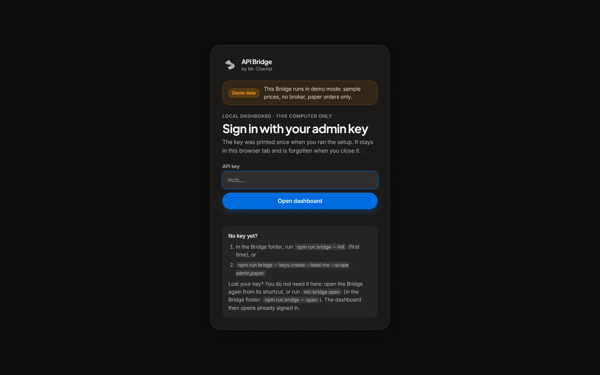

### Home (dark)

Home: welcome checklist, market snapshot, broker accounts, calls saved and safety status.

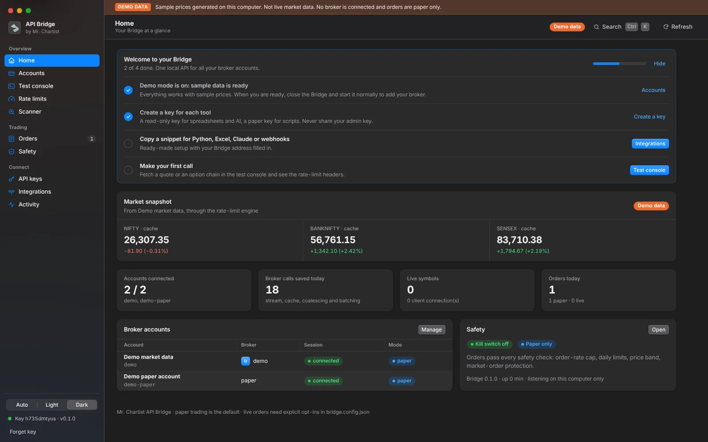

### Accounts (dark)

Accounts: your broker accounts with session state, and the directory of all 41 supported brokers.

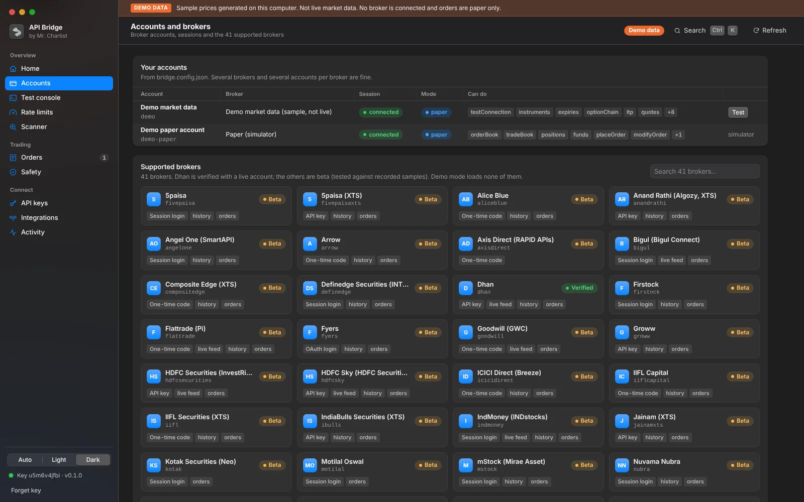

### Orders (dark)

Orders: AI-prepared tickets waiting for confirmation, today's orders and paper positions.

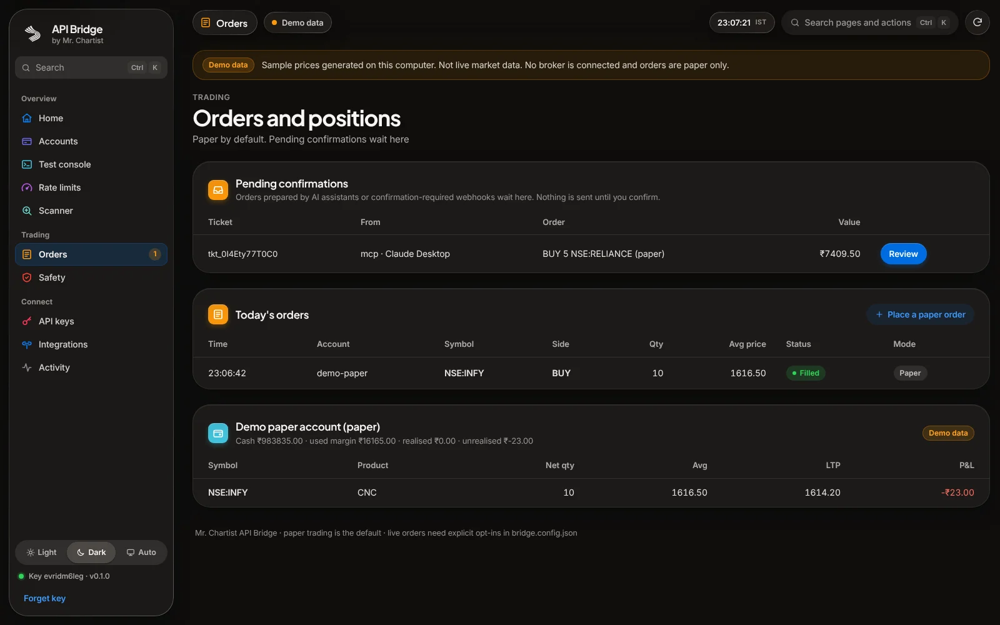

### Safety (dark)

Safety: the kill switch, daily limits per account and the live-trading checklist.

### Keys (dark)

API keys: one key per tool with its scopes, accounts, expiry and last use.

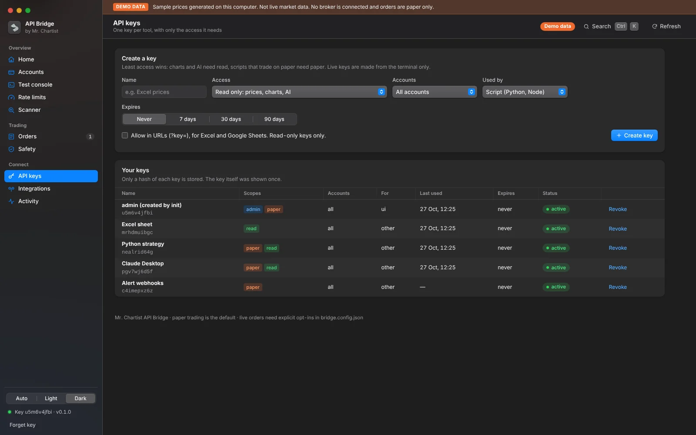

### Test console (dark)

Test console: send any API call and see the status, rate-limit headers and JSON exactly as a script gets it.

### Rate limits (dark)

Rate limits: live usage per endpoint class against the broker's limits, and the calls saved by stream, cache, coalescing and batching.

### Integrations: Python (dark)

Copy-paste setup for Python, with this Bridge's address filled in and a button that creates a key with only the access it needs.

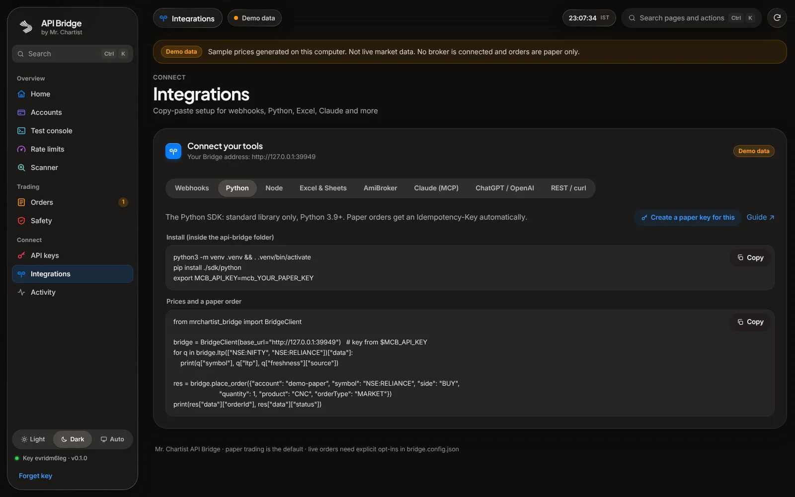

### Integrations: Node (dark)

Copy-paste setup for Node, with this Bridge's address filled in and a button that creates a key with only the access it needs.

### Integrations: Excel and Google Sheets (dark)

Copy-paste setup for Excel and Google Sheets, with this Bridge's address filled in and a button that creates a key with only the access it needs.

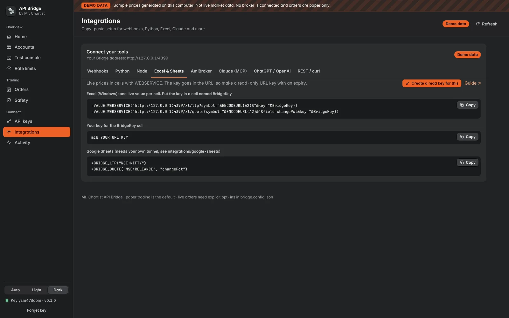

### Integrations: AmiBroker (dark)

Copy-paste setup for AmiBroker, with this Bridge's address filled in and a button that creates a key with only the access it needs.

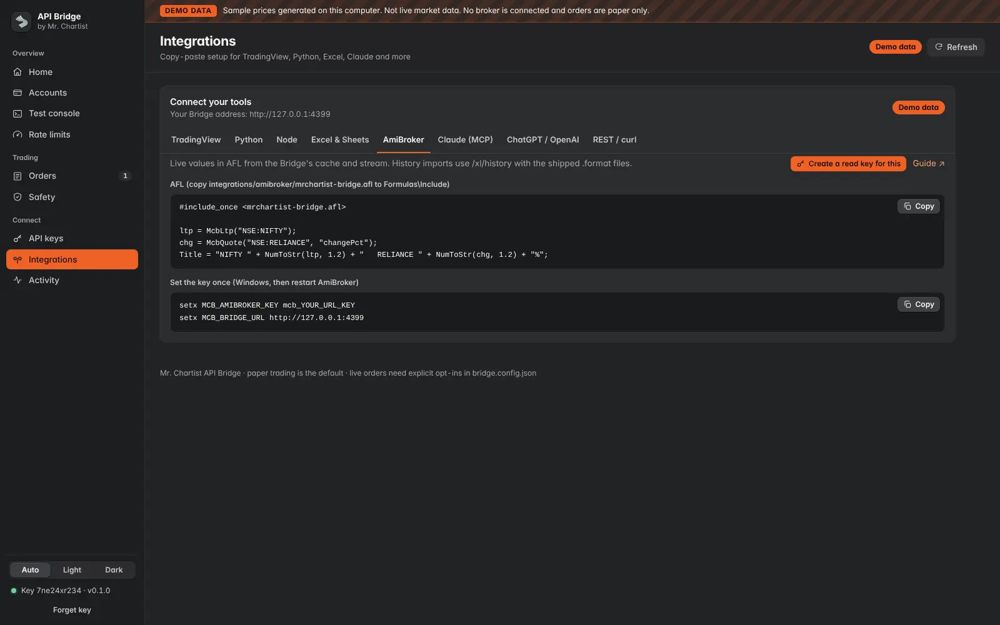

### Integrations: Claude Desktop and Claude Code (MCP) (dark)

Copy-paste setup for Claude Desktop and Claude Code (MCP), with this Bridge's address filled in and a button that creates a key with only the access it needs.

### Integrations: ChatGPT and OpenAI tools (dark)

Copy-paste setup for ChatGPT and OpenAI tools, with this Bridge's address filled in and a button that creates a key with only the access it needs.

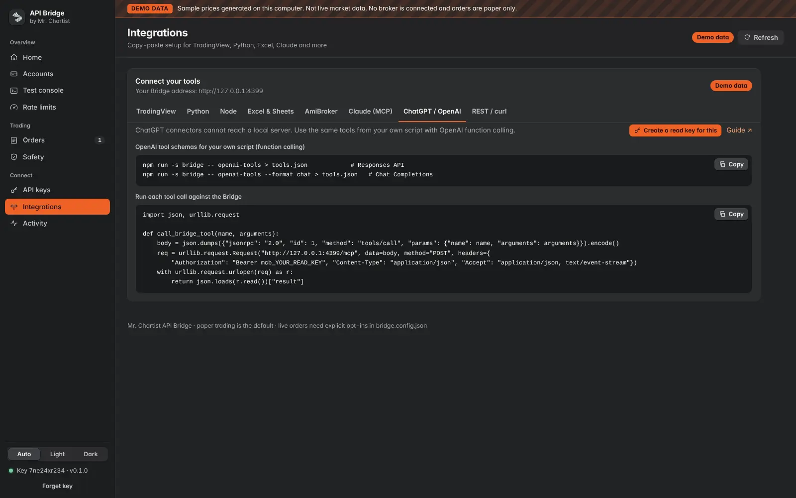

### Integrations: REST and curl (dark)

Copy-paste setup for REST and curl, with this Bridge's address filled in and a button that creates a key with only the access it needs.

### Activity: request log (dark)

Activity: the recent request log (paths only, never keys or query strings).

### Activity: audit log (dark)

Audit log: the append-only, hash-chained record of keys, orders and kill-switch actions.

## Light theme

### Sign in (light)

Sign-in screen: paste the admin key printed once by mc-bridge init. The key stays in this browser tab.

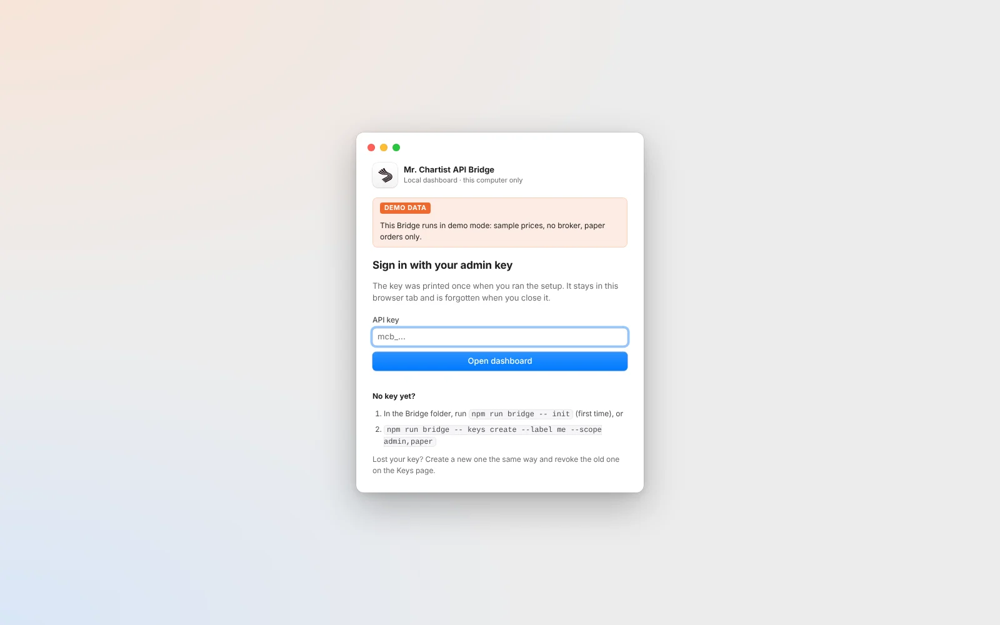

### Home (light)

Home: welcome checklist, market snapshot, broker accounts, calls saved and safety status.

### Accounts (light)

Accounts: your broker accounts with session state, and the directory of all 41 supported brokers.

### Orders (light)

Orders: AI-prepared tickets waiting for confirmation, today's orders and paper positions.

### Safety (light)

Safety: the kill switch, daily limits per account and the live-trading checklist.

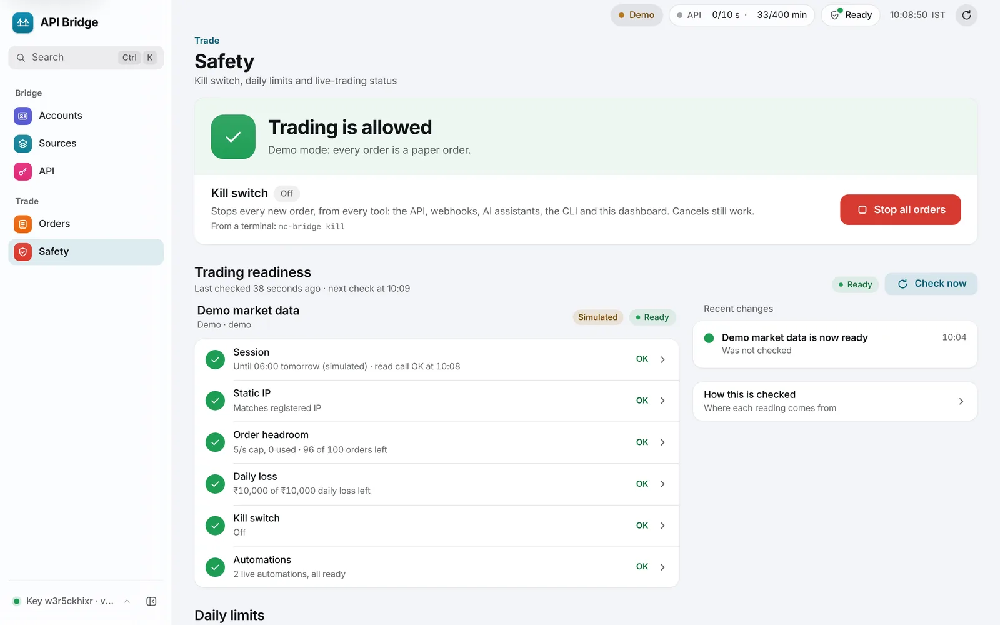

### Keys (light)

API keys: one key per tool with its scopes, accounts, expiry and last use.

### Test console (light)

Test console: send any API call and see the status, rate-limit headers and JSON exactly as a script gets it.

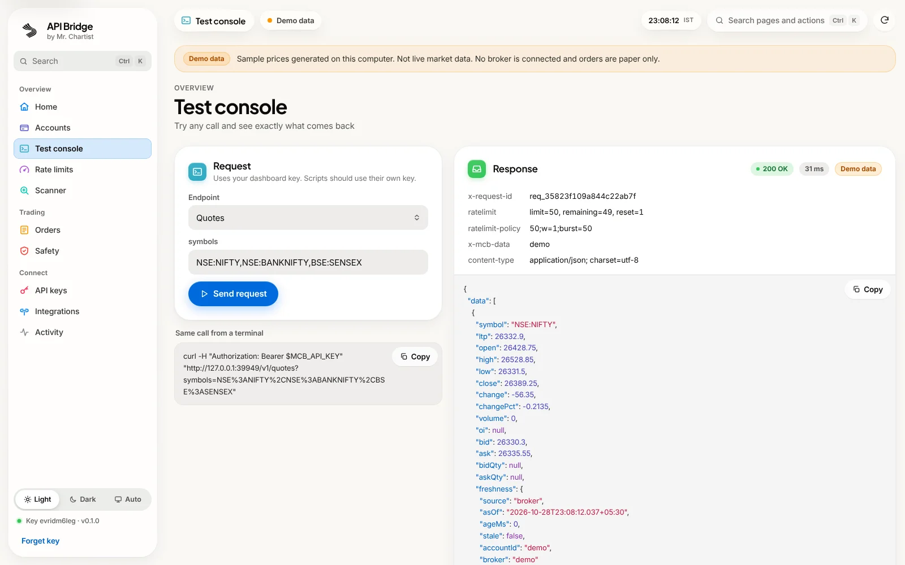

### Rate limits (light)

Rate limits: live usage per endpoint class against the broker's limits, and the calls saved by stream, cache, coalescing and batching.

### Integrations: Python (light)

Copy-paste setup for Python, with this Bridge's address filled in and a button that creates a key with only the access it needs.

### Integrations: Node (light)

Copy-paste setup for Node, with this Bridge's address filled in and a button that creates a key with only the access it needs.

### Integrations: Excel and Google Sheets (light)

Copy-paste setup for Excel and Google Sheets, with this Bridge's address filled in and a button that creates a key with only the access it needs.

### Integrations: AmiBroker (light)

Copy-paste setup for AmiBroker, with this Bridge's address filled in and a button that creates a key with only the access it needs.

### Integrations: Claude Desktop and Claude Code (MCP) (light)

Copy-paste setup for Claude Desktop and Claude Code (MCP), with this Bridge's address filled in and a button that creates a key with only the access it needs.

### Integrations: ChatGPT and OpenAI tools (light)

Copy-paste setup for ChatGPT and OpenAI tools, with this Bridge's address filled in and a button that creates a key with only the access it needs.

### Integrations: REST and curl (light)

Copy-paste setup for REST and curl, with this Bridge's address filled in and a button that creates a key with only the access it needs.

### Activity: request log (light)

Activity: the recent request log (paths only, never keys or query strings).

### Activity: audit log (light)

Audit log: the append-only, hash-chained record of keys, orders and kill-switch actions.

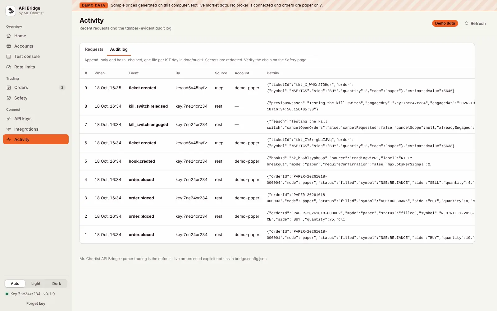

## Features

### Welcome checklist

First-run checklist: connect a broker or try demo mode, create a key, copy a snippet, make a test call.

### Live rate-limit usage

Per-account budgets per endpoint class, refreshed every few seconds, after 20 identical requests were coalesced.

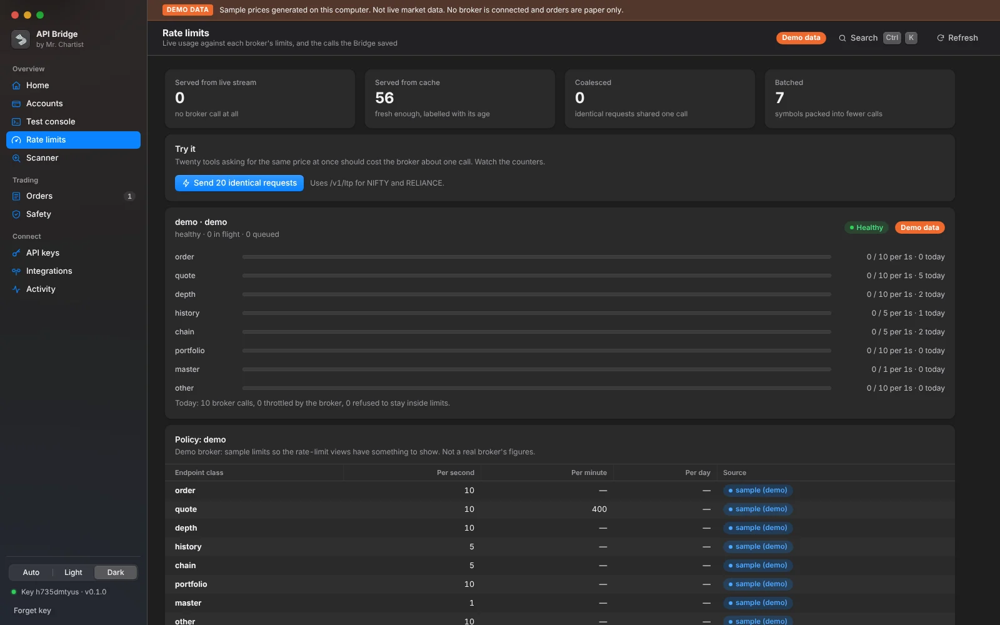

### Test console with a response

An option-chain call with Greeks: status, timing, request id, rate-limit headers and the JSON, labelled Demo data.

### Snippet panel: Python

Ready-to-paste Python setup with copy buttons.

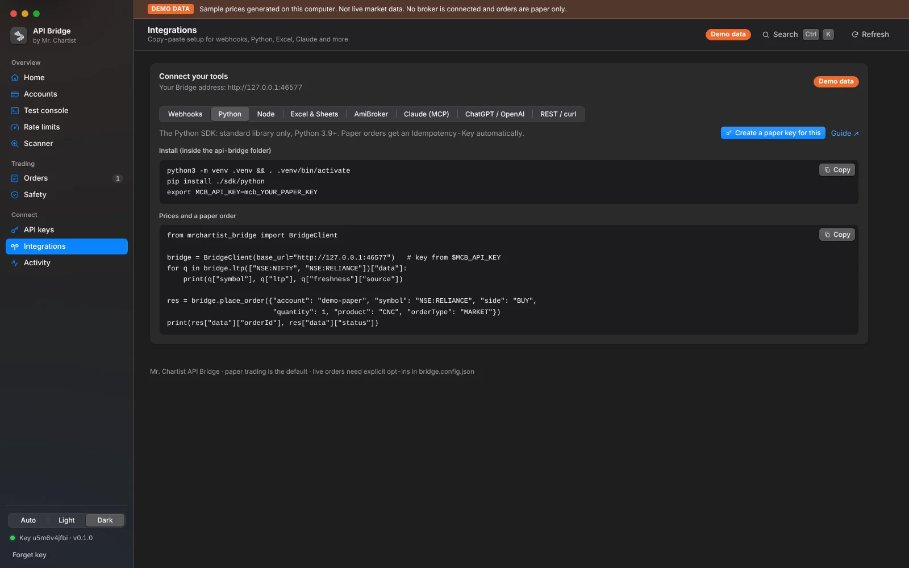

### Snippet panel: Excel and Google Sheets

Ready-to-paste Excel and Google Sheets setup with copy buttons.

### Snippet panel: Claude Desktop and Claude Code (MCP)

Ready-to-paste Claude Desktop and Claude Code (MCP) setup with copy buttons.

### Kill switch: confirm

Stopping all orders asks for a reason and whether to cancel open orders.

### Kill switch engaged

With the kill switch on, every new order from every tool is refused until an admin releases it.

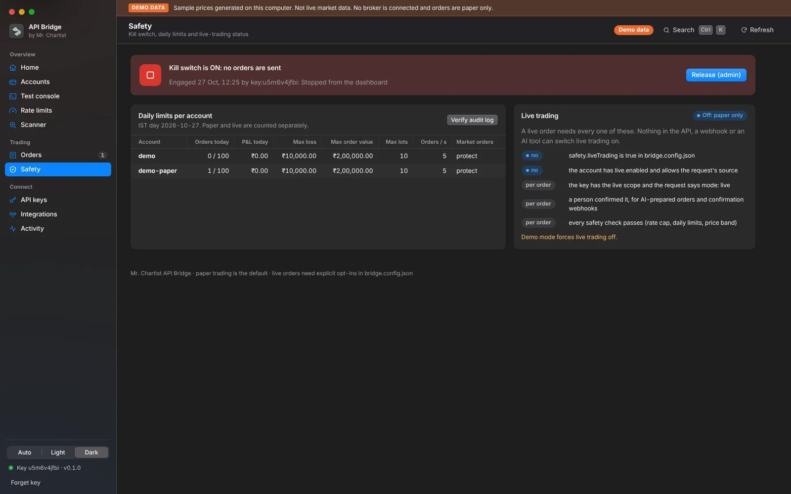

### API keys with scopes

A new key is shown once; every key lists its scopes (read, paper, admin), accounts, client and expiry.

### Confirming an AI-prepared order

An order prepared by Claude over MCP: every field is shown before a person confirms it. Nothing is sent until then.

### Request log

Every request from scripts, charts, Excel and AI tools: method, path, status, time and key id.

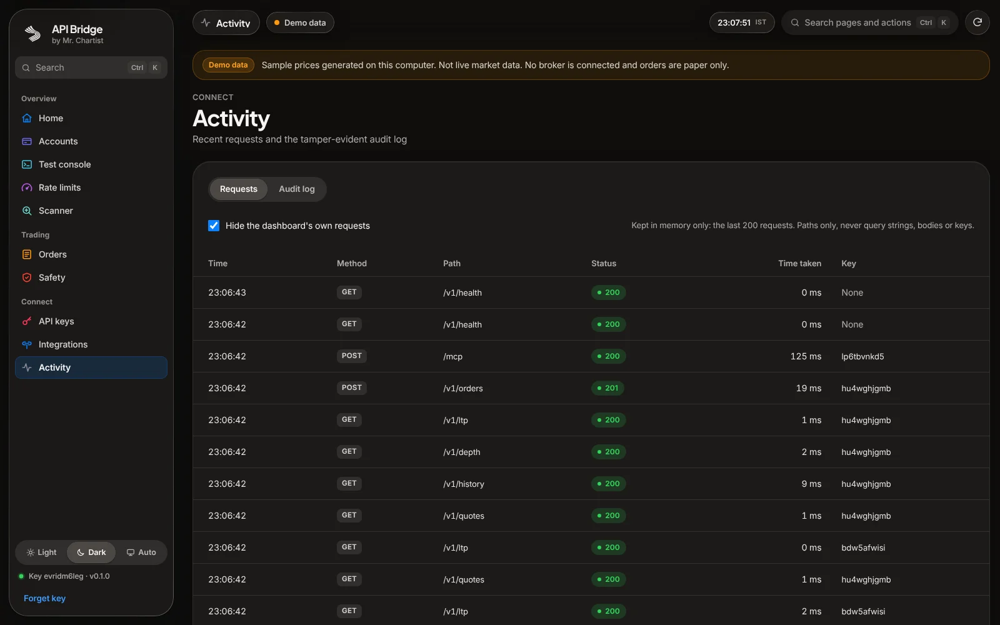

## Phone

### Mobile: home (dark)

Home: welcome checklist, market snapshot, broker accounts, calls saved and safety status. (390 x 844 at 2x)

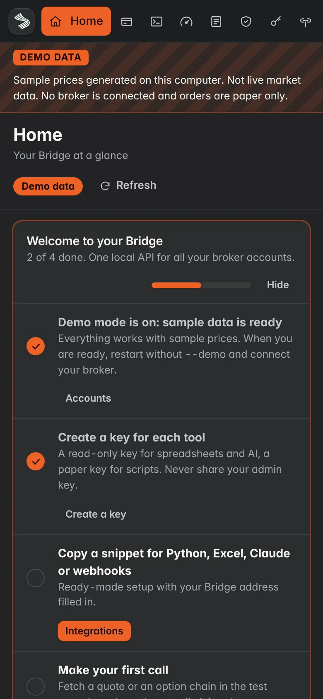

### Mobile: console (dark)

Test console: send any API call and see the status, rate-limit headers and JSON exactly as a script gets it. (390 x 844 at 2x)

### Mobile: integrations (dark)

Integrations on a phone. (390 x 844 at 2x)

### Mobile: safety (dark)

Safety: the kill switch, daily limits per account and the live-trading checklist. (390 x 844 at 2x)

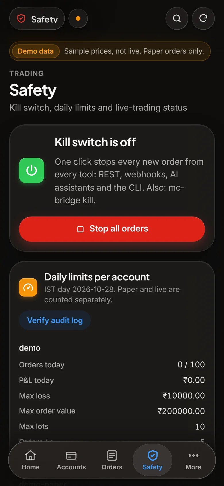

### Mobile: home (light)

Home: welcome checklist, market snapshot, broker accounts, calls saved and safety status. (390 x 844 at 2x)

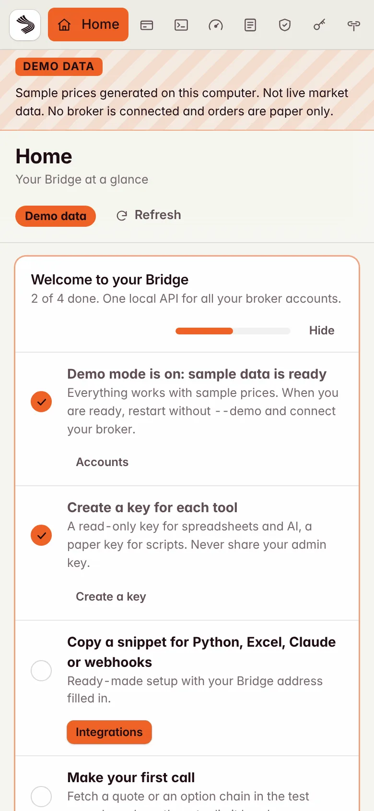

### Mobile: console (light)

Test console: send any API call and see the status, rate-limit headers and JSON exactly as a script gets it. (390 x 844 at 2x)

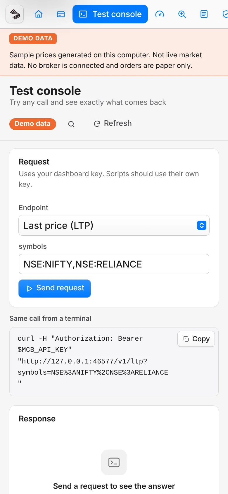

### Mobile: integrations (light)

Integrations on a phone. (390 x 844 at 2x)

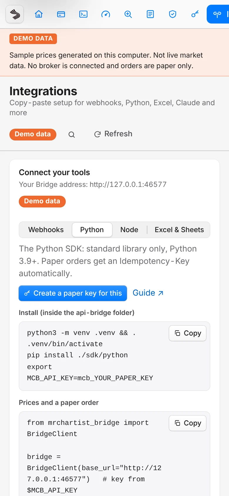

### Mobile: safety (light)

Safety: the kill switch, daily limits per account and the live-trading checklist. (390 x 844 at 2x)

